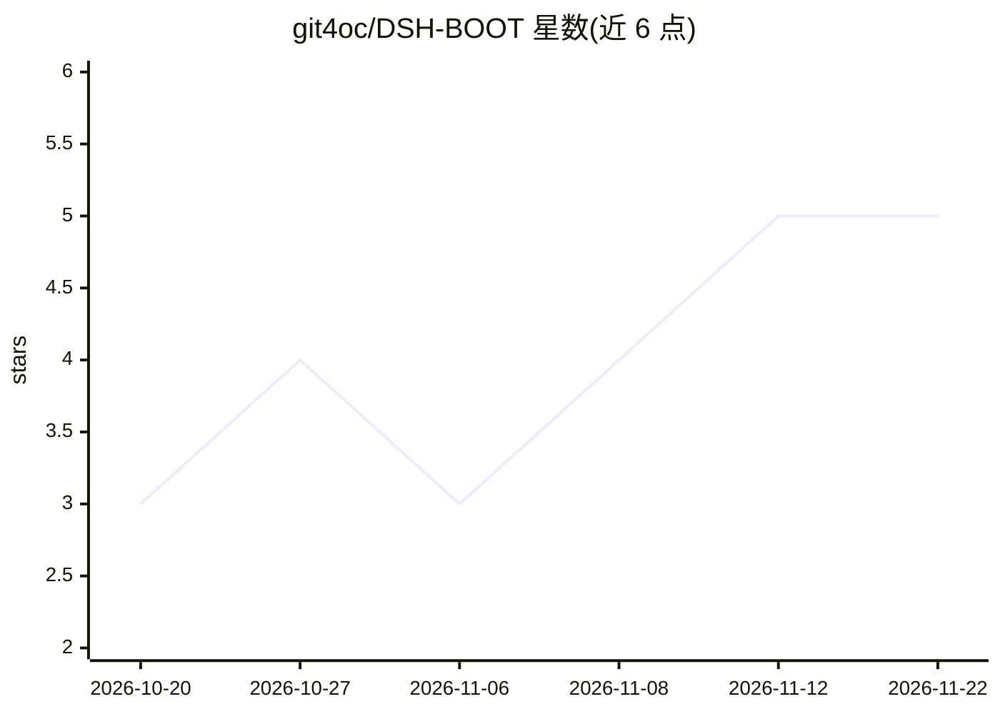

# git4oc/DSH-BOOT

⭐ 5 · TypeScript · MIT · 推送 2026-11-02 · [GitHub](https://github.com/git4oc/DSH-BOOT) · 个人维护 · 中文 README

**面向企业的 DSH 内核多租户 AI Agent 平台**

以 DSH（DeepSeek harness）开源内核为基础的平台软件，在其之上补齐企业级外层能力：多租户隔离域、JWT+RBAC 身份、fail-closed 审计与 WORM 哈希链、配额计费、DSR 数据删除、会话持久化与升级门禁。由控制面服务（TypeScript 包）、DSH 集成（反向网关桩+域桥）与 397 条规格的门禁体系组成；不修改内核，业务方只需定义场景/工具/连接器/技能四类资产。限制：无 UI，生产部署需自备 Linux 容器等基础设施，反向网关为桩实现，Windows 排除。

## 筛选速览

| 维度 | 判定 | 备注 |
|---|---|---|
| AI 角色 | `ai-ecosystem` | LLM/agent 周边工具 |
| 许可风险 | `permissive` | MIT |
| 部署形态 | `library` | 以包/库形式分发 |
| 模型依赖 | — | README 未给出锁定关系 |
| 硬件要求 | — | 无带数字的原话,不猜 |
| 安装摩擦 | `low` | 无编译、无系统依赖或容器化 |
| 成熟度 | `idea` | |

## 能力要点

- 多租户隔离域：一 (tenantId, isolationGroupId) 一隔离域，跨租户不共享
- fail-closed 审计 + WORM 哈希链 + DSR 删除证明，取证包可独立验证
- 12 个契约套件钉死平台承诺（跨租户不可见、审批不自动重试等）
- 升级流水线五道 gate 与迁移状态机，防止升级破坏客户数据

## 适用场景

- 在企业内把业务场景接入 AI Agent 并做多租户本地化部署
- 需要审计留痕、配额计费与数据删除合规的 Agent 平台建设
- 基于 DSH 内核快速搭建而不重复造隔离与审计的轮子

## 场景标签

`Agent 框架` · 领域:Agent 开发

## 证据(README 行号)

> L92: 那么 DSH-BOOT 到底是什么？它是一个**多租户 AI Agent 平台软件**，由三部分组成：
> L98: 它不重写 DSH：每个 Agent 仍由 DSH 内核运行；DSH-BOOT 把很多个这样的 Agent 管成一家企业的多租户平台。部署形态：控制面服务 + 每隔离域一个 DSH 实例（Linux 容器）+ 网关。
> L116: 对应关系一句话：**DSH 之于 DSH-BOOT，约等于 JVM 之于 Spring Boot**——内核管单实例运行时，平台管多租户的企业级语义。

## 星数曲线

2026-10-20 3 → 2026-11-22 5（+2）

---
*卡片 v1 · prompt 1.4 · 生成 2026-11-21 · 置信度 mid · 依据 README sha `f4f119206bcd` · [字段定义](../../DATASET.md)*
