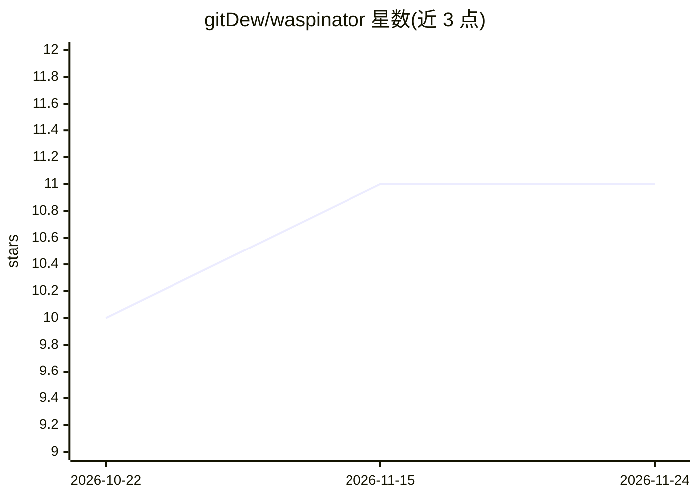

# gitDew/waspinator

⭐ 11 · Python · AGPL-3.0 · 推送 2026-09-18 · [GitHub](https://github.com/gitDew/waspinator) · [官网](https://betterask.erni) · 组织维护

**用 AI 识别并诱捕入侵黄脚胡蜂、避免误伤本地胡蜂的陷阱工具**

Python 工具，使用 Ultralytics YOLO 目标检测模型区分入侵物种 Vespa velutina 与本地物种 Vespa crabro，仅对前者触发捕捉装置。支持从摄像头、图片、视频或 CSV 文件实时检测，提供 --dry-run 模拟模式与舵机控制的陷阱硬件触发。附 Raspberry Pi 5 部署流程与 3D 打印陷阱外壳的 .stl 模型文件，由 ERNI Lab42 团队开发。

## 筛选速览

| 维度 | 判定 | 备注 |
|---|---|---|
| AI 角色 | `ai-native` | 本体是模型或模型工具 |
| 许可风险 | `viral` | AGPL-3.0 |
| 部署形态 | `library` | 以包/库形式分发 |
| 模型依赖 | — | README 未给出锁定关系 |
| 硬件要求 | — | 无带数字的原话,不猜 |
| 安装摩擦 | `low` | 无编译、无系统依赖或容器化 |
| 成熟度 | — | 结构信号不足 |

## 能力要点

- YOLO 目标检测区分 Vespa velutina 与 Vespa crabro
- 支持摄像头、图片、视频、CSV 多种输入源
- 自动化触发或 dry-run 模拟两种陷阱模式
- 提供陷阱 3D 打印 .stl 模型与树莓派部署指南

## 适用场景

- 在蜂场附近部署自动诱捕装置防控入侵胡蜂
- 用视频或图片批量检测胡蜂种类
- 自行 3D 打印外壳组装智能陷阱

## 场景标签

`目标检测` · 领域:感知与多模态

## 证据(README 行号)

> L3: A Python tool for **detecting and catching the invasive _Vespa velutina_**, while recognizing and **not triggering o
> L30: - Accurate distinction between *Vespa velutina* and *Vespa crabro*
> L48: If you want to run Waspinator directly on a Raspberry Pi 5 (in your own 3D printed trap), follow these steps to set

## 星数曲线

2026-10-22 10 → 2026-11-24 11（+1）

---
*卡片 v1 · prompt 1.4 · 生成 2026-11-18 · 置信度 high · 依据 README sha `0cdcecb71249` · [字段定义](../../DATASET.md)*
