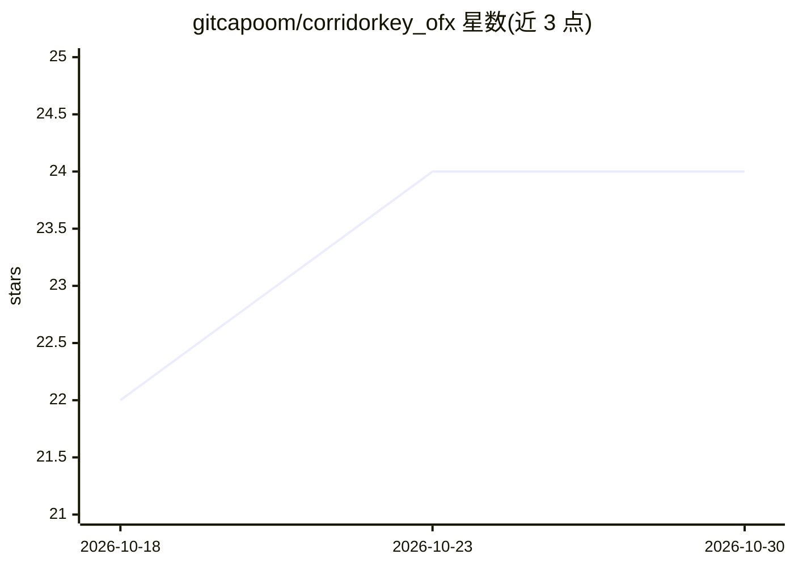

# gitcapoom/corridorkey_ofx

⭐ 24 · C++ · NOASSERTION · 推送 2026-08-04 · [GitHub](https://github.com/gitcapoom/corridorkey_ofx) · 个人维护

**把 CorridorKey AI 抠像引擎接入 DaVinci Resolve 的 OFX 插件**

面向 DaVinci Resolve 20 用户的 Windows 版 OFX 插件：以 C++ 插件处理 Resolve 集成（UI、帧 I/O、节点图），后台 Python 进程经 PyTorch 运行 CorridorKey 与 BiRefNet 推理，二者通过共享内存与命名管道通信，首次应用时自动启动后端。提供抠像、溢色去除、去斑、CNN 精修等参数，输出线性 RGBA。限制：仅支持 Windows 10/11，需 NVIDIA CUDA GPU（RTX 4090 上测试），首次渲染有约 60 秒 torch.compile 预热。许可证为 CC BY-NC-SA 4.0。

## 筛选速览

| 维度 | 判定 | 备注 |
|---|---|---|
| AI 角色 | `ai-native` | 本体是模型或模型工具 |
| 许可风险 | `none` | NOASSERTION |
| 部署形态 | `desktop` | 安装包/桌面程序 |
| 模型依赖 | — | README 未给出锁定关系 |
| 硬件要求 | — | 无带数字的原话,不猜 |
| 安装摩擦 | `high` | 编译与系统依赖俱全 |
| 成熟度 | — | 结构信号不足 |

## 能力要点

- C++ OFX 插件 + Python PyTorch 后端的架构，共享内存传帧、命名管道传控制消息
- BiRefNet 生成 alpha 提示，支持 Auto/External 两种模式
- fp16 推理与 torch.compile + Triton 内核优化，RTX 4090 上单帧约 3 秒
- 安装脚本自动完成插件复制、环境创建、依赖与模型权重下载

## 适用场景

- 在 DaVinci Resolve 中用 AI 对绿幕素材做抠像与合成
- 摄影棚/线性色彩流程（ACES、EXR）下的抠像处理
- 输出 matte、前景、预览合成等多种模式供合成使用

## 场景标签

`图像视频处理` · 领域:感知与多模态

## 证据(README 行号)

> L3: An OFX plugin that brings CorridorKey — Corridor Digital's AI-powered green screen keyer — into DaVinci Resolve 20 a
> L7: CorridorKey produces physically accurate foreground color unmixing with clean linear alpha channels. This plugin wra

## 星数曲线

2026-10-18 22 → 2026-10-30 24（+2）

---
*卡片 v1 · prompt 1.4 · 生成 2026-10-27 · 置信度 mid · 依据 README sha `d3aa10b8e3ab` · [字段定义](../../DATASET.md)*
