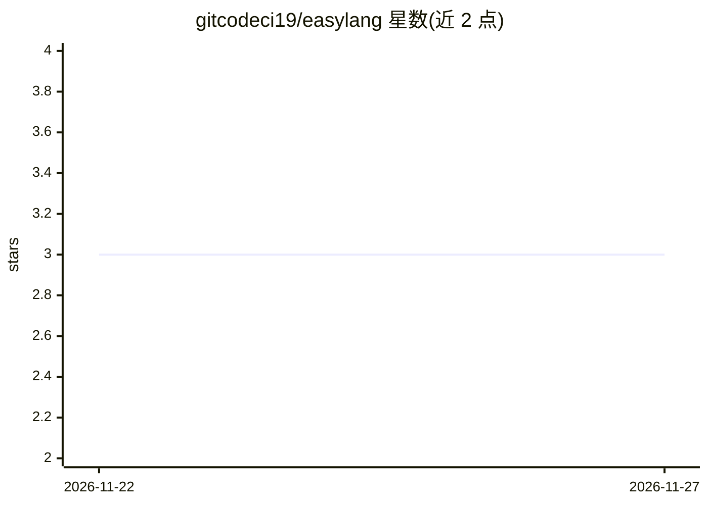

# gitcodeci19/easylang

⭐ 3 · TypeScript · GPL-3.0 · 推送 2026-11-24 · [GitHub](https://github.com/gitcodeci19/easylang) · 个人维护

**面向英语学习者的浏览器扩展：在任意网页生成 AI 课程与卡片**

LingoEx 是一款浏览器扩展（Chrome/Edge/Brave，开发者模式加载），提供类似 Duolingo 的交互式英语课程，在浏览器打开期间每 20 分钟弹出练习题，并可在观看 YouTube 等场景中标记错误并给出 AI 解释。用户需自行申请免费的 LLM API 密钥（Groq 为主，NVIDIA、AMD 为备选），密钥存储在浏览器本地。提供 Releases 安装包，也可从源码用 npm 构建。项目声明与 easylang.com 无关联，许可为 GPL-3.0。

## 筛选速览

| 维度 | 判定 | 备注 |
|---|---|---|
| AI 角色 | `ai-native` | 本体是模型或模型工具 |
| 许可风险 | `viral` | GPL-3.0 |
| 部署形态 | `library` | 以包/库形式分发 |
| 模型依赖 | locked-api |  |
| 硬件要求 | — | 无带数字的原话,不猜 |
| 安装摩擦 | `low` | 无编译、无系统依赖或容器化 |
| 成熟度 | — | 结构信号不足 |

## 能力要点

- 在任意浏览器标签页生成交互式英语课程
- 分析对错并生成针对薄弱点的个人课程
- 每 20 分钟自动弹出练习的提醒机制
- 支持 Groq/NVIDIA/AMD 三家免费 API 通道，可配置主/备密钥

## 适用场景

- 浏览网页时穿插练习英语
- 看 YouTube 时让 AI 解释理解错误
- 用免费 API 密钥零成本使用 AI 课程生成

## 场景标签

 · 领域:教育/语言学习

## 证据(README 行号)

> L19: - Yapay zekâ hatalarınızı ve doğrularınızı analiz ederek eksiklerinize odaklanan kişisel dersler oluşturur.
> L28: Groq, NVIDIA ve AMD gibi şirketler, geliştiricilerin kullanabilmesi için ücretsiz API erişimi sunuyor. Bu sayede ke

## 星数曲线

2026-11-22 3 → 2026-11-27 3（+0）

---
*卡片 v1 · prompt 1.4 · 生成 2026-11-22 · 置信度 high · 依据 README sha `cf28715f99d1` · [字段定义](../../DATASET.md)*
