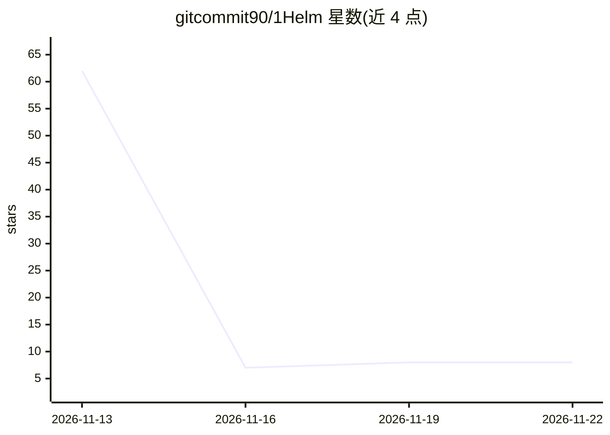

# gitcommit90/1Helm

⭐ — · [GitHub]() · 个人维护

**部署到自有 Cloudflare 账户的个人 AI 工作区，带持久记忆与沙盒计算机**

包含 Worker、Web 应用、channel computer 容器镜像及可选手机/桌面客户端，可部署到用户自己的 Cloudflare 账户。机制：以 Channel 组织对话、记忆与 Notebook 实现跨任务持久上下文；agent 在 Cloudflare 托管的 channel computer 上运行代码并操作文件，工作区持久化；AI 侧为 bring-your-own：用户在设置中填入 OpenAI 兼容端点、模型与密钥。限制：公共安装为单所有者服务器（首个登录邮箱成为所有者），是全新安装而非旧 Linux 服务器产品的原地升级；需 Workers Paid 账户与 Cloudflare DNS 域名。

## 筛选速览

| 维度 | 判定 | 备注 |
|---|---|---|
| AI 角色 | `ai-native` | 本体是模型或模型工具 |
| 许可风险 | `none` | — |
| 部署形态 | `self-host` | docker 或自建部署 |
| 模型依赖 | — | README 未给出锁定关系 |
| 硬件要求 | — | 无带数字的原话,不猜 |
| 安装摩擦 | `low` | 无编译、无系统依赖或容器化 |
| 成熟度 | — | 结构信号不足 |

## 能力要点

- Channel 集合对话、记忆与 Notebook，跨任务保持上下文
- Cloudflare 托管的 channel computer 供 agent 运行代码、操作文件，工作区持久化
- 自带 AI：接入任意 OpenAI 兼容 chat completions 端点与密钥
- Web/PWA 之外提供可选手机与桌面客户端（apps/）

## 适用场景

- 在自己的 Cloudflare 账户上托管一个私人 AI 助手工作区
- 让 agent 在持久化沙盒里写代码、做文件处理任务
- 用自有 AI 服务商密钥控制模型与用量成本

## 场景标签

`AI 助手` · 领域:对话与助手

## 证据(README 行号)

> L16: 1Helm is a personal AI workspace on Cloudflare. This repository contains the Worker, web app, channel computer imag
> L22: - **Bring your own AI.** Connect an OpenAI-compatible provider using your own endpoint, model, and key.
> L21: - **Give your agent a computer.** Run code and work with files in a channel computer hosted on Cloudflare, with a p

## 星数曲线

2026-11-13 62 → 2026-11-22 8（-54）

---
*卡片 v1 · prompt 1.4 · 生成 2026-11-20 · 置信度 mid · 依据 README sha `9143deeb9a02` · [字段定义](../../DATASET.md)*
