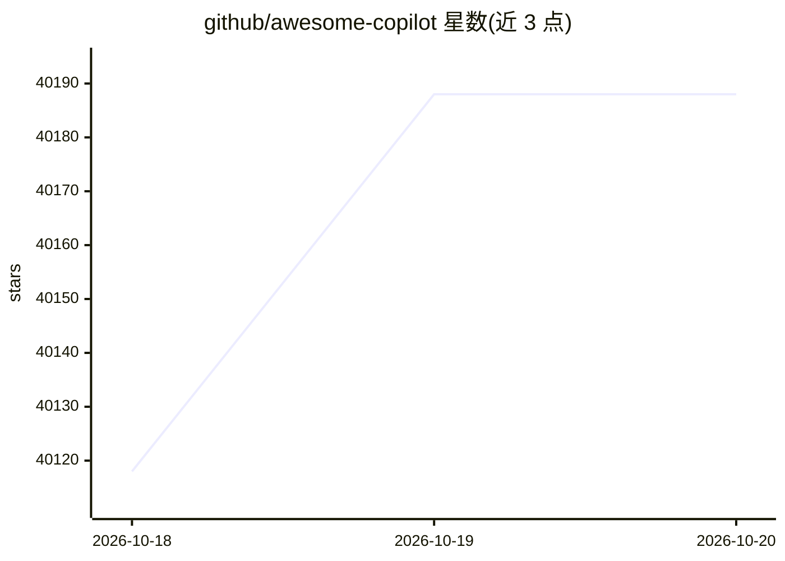

# github/awesome-copilot

⭐ 40,188 · JavaScript · MIT · 推送 2026-10-16 · [GitHub](https://github.com/github/awesome-copilot) · [官网](https://awesome-copilot.github.com/) · 组织维护

**为 GitHub Copilot 用户提供社区贡献的自定义 agent 与配置集合**

社区创建的资源集合，收录自定义 agents、instructions、skills、hooks、workflows 与 plugins，供 GitHub Copilot 用户扩展其工作方式。资源按 Agents（可集成 MCP 服务器）、Instructions（按文件模式自动应用）、Skills、Plugins（打包组合）、Cookbook（API 配方）等类别组织；配套网站提供全文检索、筛选与 Learning Hub 教程，并提供机器可读的 llms.txt。通过 Copilot CLI/VS Code 的 marketplace 安装插件。

## 筛选速览

| 维度 | 判定 | 备注 |
|---|---|---|
| AI 角色 | `ai-ecosystem` | LLM/agent 周边工具 |
| 许可风险 | `permissive` | MIT |
| 部署形态 | `None` |  |
| 模型依赖 | — | README 未给出锁定关系 |
| 硬件要求 | — | 无带数字的原话,不猜 |
| 安装摩擦 | `low` | 无编译、无系统依赖或容器化 |
| 成熟度 | — | 结构信号不足 |

## 动量与使用信号

- 维护:`active` — 距上次 push 1.4 天,年发版 0,435 位贡献者
- 涨星:近 1 天 **+50**(自 20261016 起算)
- 安装:github 包 `release-assets` 月下载无数据
- 平台:— · 协议:MCP

## 能力要点

- 收录 agents、instructions、skills、hooks、workflows、plugins 六类资源
- Agents 支持集成 MCP 服务器；Instructions 按文件模式自动应用
- 提供 copilot plugin install 命令行安装插件
- 网站提供全文检索与 Learning Hub 教程，并提供 llms.txt 供 AI agent 读取

## 适用场景

- 为 GitHub Copilot 查找社区维护的自定义 agent 与 skills
- 按文件模式为团队应用统一的编码规范指令
- 通过 Copilot CLI 一键安装打包好的插件组合

## 场景标签

`精选清单` · 领域:学习与行业

## 证据(README 行号)

> L4: A community-created collection of custom agents, instructions, skills, hooks, workflows, and plugins to supercharge 
> L23: |🤖 Agents|Specialized Copilot agents that integrate with MCP servers|All agents →|
> L31: ## Install a Plugin

## 星数曲线

2026-10-18 40,118 → 2026-10-20 40,188（+70）

---
*卡片 v1 · prompt 1.4 · 生成 2026-10-18 · 置信度 high · 依据 README sha `fbb51d16dc76` · [字段定义](../../DATASET.md)*
