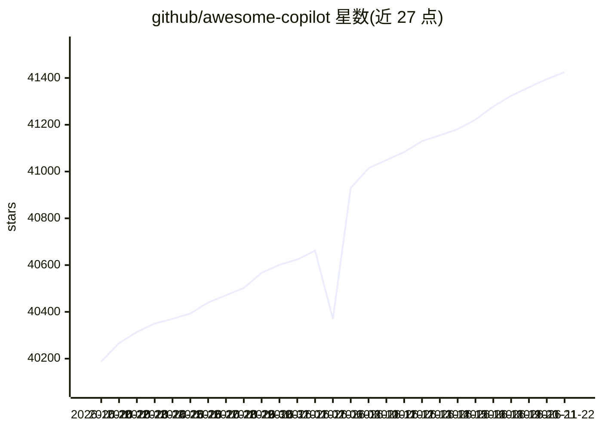

# github/awesome-copilot

⭐ 41,425 · JavaScript · MIT · 推送 2026-11-20 · [GitHub](https://github.com/github/awesome-copilot) · [官网](https://awesome-copilot.github.com/) · 中文 README

**GitHub Copilot 社区贡献的 agents/指令/技能配置合集**

社区创建的 GitHub Copilot 定制资源集合，包含自定义 agents、编码规范指令、skills、hooks、workflows 与 plugins，按资源类型分类浏览，配套网站提供全文搜索、过滤与 Learning Hub 教程。提供 Copilot CLI 插件市场，用户可通过 copilot plugin install 命令安装插件包；另提供 llms.txt 机器可读清单供 AI agent 读取。贡献者列表列出数百位社区成员。

## 筛选速览

| 维度 | 判定 | 备注 |
|---|---|---|
| AI 角色 | `ai-knowledge` | 知识聚合/清单类 |
| 许可风险 | `permissive` | MIT |
| 部署形态 | `None` |  |
| 模型依赖 | — | README 未给出锁定关系 |
| 硬件要求 | — | 无带数字的原话,不猜 |
| 安装摩擦 | `low` | 无编译、无系统依赖或容器化 |
| 成熟度 | — | 结构信号不足 |

## 动量与使用信号

- 维护:`active` — 距上次 push 1.4 天,年发版 0,435 位贡献者
- 涨星:近 1 天 **+50**(自 20261016 起算)
- 安装:github 包 `release-assets` 月下载无数据
- 平台:— · 协议:MCP

## 能力要点

- 包含 agents、instructions、skills、plugins、hooks、workflows 六类资源
- Copilot CLI 插件市场一键安装（copilot plugin install）
- 配套网站提供全文搜索、过滤与 Learning Hub 教程
- 提供 llms.txt 机器可读结构化清单

## 适用场景

- 为 GitHub Copilot 查找社区定制的 agents 与技能
- 按文件模式自动应用团队编码规范指令
- 通过插件市场安装面向特定工作流的 agent/skill 组合
- 通过 Learning Hub 学习 Copilot 定制与 MCP 集成

## 场景标签

`提示工程` `精选清单` `工作流自动化` `教程课程` · 领域:Agent 开发

## 证据(README 行号)

> L4: A community-created collection of custom agents, instructions, skills, hooks, workflows, and plugins to supercharge 
> L23: |🤖 Agents|Specialized Copilot agents that integrate with MCP servers|All agents →|
> L25: |🎯 Skills|Self-contained folders with instructions and bundled assets|All skills →|

## 星数曲线

2026-10-20 40,188 → 2026-11-22 41,425（+1,237）

---
*卡片 v1 · prompt 1.4 · 生成 2026-11-22 · 置信度 high · 依据 README sha `93100cd18bdf` · [字段定义](../../DATASET.md)*
