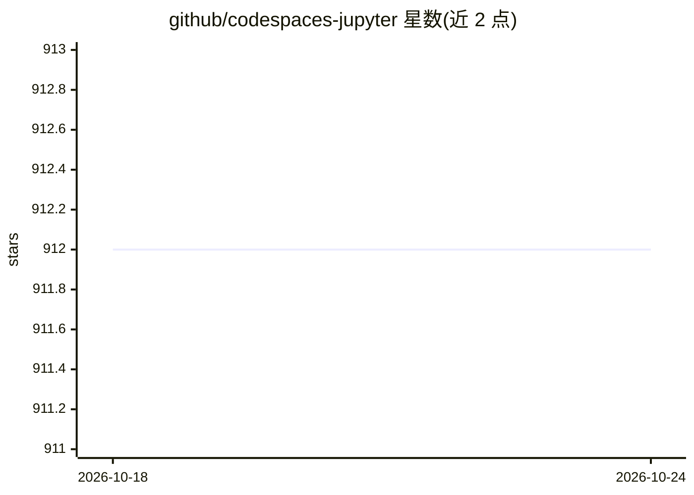

# github/codespaces-jupyter

⭐ 912 · Jupyter Notebook · MIT · 推送 2026-08-11 · [GitHub](https://github.com/github/codespaces-jupyter) · 组织维护

**GitHub Codespaces 的 Jupyter 笔记本起步模板**

GitHub 官方提供的 Codespaces 起步模板仓库，预配置 Python 与 Jupyter 笔记本环境，供用户在云端开发容器中探索机器学习与数据科学。仓库含单一初始提交，用户所做修改仅保存在该 codespace 内，可通过 "Publish Branch" 将其发布为 GitHub 仓库，也可直接删除。README 未给出产品级安装命令或 AI 功能描述。

## 筛选速览

| 维度 | 判定 | 备注 |
|---|---|---|
| AI 角色 | `ai-ecosystem` | LLM/agent 周边工具 |
| 许可风险 | `permissive` | MIT |
| 部署形态 | `None` |  |
| 模型依赖 | — | README 未给出锁定关系 |
| 硬件要求 | — | 无带数字的原话,不猜 |
| 安装摩擦 | `low` | 无编译、无系统依赖或容器化 |
| 成熟度 | — | 结构信号不足 |

## 能力要点

- 预配置 Python 与 Jupyter 笔记本的 Codespaces 环境
- 单初始提交，可作为项目起点发布为新仓库
- 改动仅存在于 codespace 内，可随时删除

## 适用场景

- 在浏览器中快速获得 Jupyter 笔记本环境做数据科学探索
- 以模板起步创建并发布自己的机器学习项目仓库

## 场景标签

 · 领域:开发环境/数据科学

## 证据(README 行号)

> L1: # GitHub Codespaces ♥️ Jupyter Notebooks
> L3: Welcome to your shiny new codespace! We've got everything fired up and running for you to explore Python and Jupyter

## 星数曲线

2026-10-18 912 → 2026-10-24 912（+0）

---
*卡片 v1 · prompt 1.4 · 生成 2026-10-21 · 置信度 low · 依据 README sha `9b1730becc15` · [字段定义](../../DATASET.md)*
