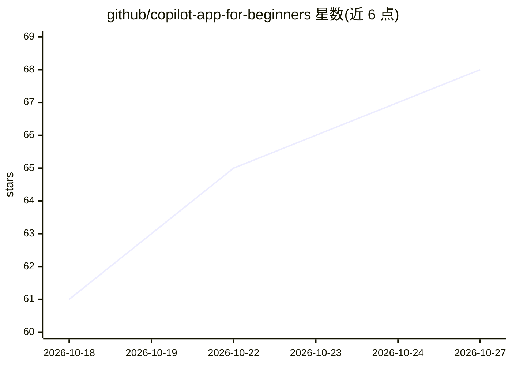

# github/copilot-app-for-beginners

⭐ 68 · HTML · MIT · 推送 2026-10-25 · [GitHub](https://github.com/github/copilot-app-for-beginners) · [官网](https://gh.io/copilot-app-course) · 组织维护

**GitHub Copilot 桌面应用入门课程：教你指挥 AI 编码 agent**

GitHub 官方维护的入门教程仓库，主题为 GitHub Copilot app——一个用于指挥、观察和验证编码 agent 工作的桌面控制中心。课程含 8 个章节（00-07），覆盖应用安装、worktree 隔离会话、Interactive/Plan/Autopilot 三种模式、技能与自定义 agent、MCP 服务器、插件、画板与自动化，配 React/Vite 示例工程 samples/book-app-web，面向无需 agent 经验的开发者与学习者。本仓库本身为教学内容，不含可安装的软件产品。

## 筛选速览

| 维度 | 判定 | 备注 |
|---|---|---|
| AI 角色 | `ai-knowledge` | 知识聚合/清单类 |
| 许可风险 | `permissive` | MIT |
| 部署形态 | `None` |  |
| 模型依赖 | — | README 未给出锁定关系 |
| 硬件要求 | — | 无带数字的原话,不猜 |
| 安装摩擦 | `low` | 无编译、无系统依赖或容器化 |
| 成熟度 | — | 结构信号不足 |

## 能力要点

- 8 章课程覆盖会话、worktrees、上下文、技能、MCP、插件、画板与自动化
- 配 React/Vite 示例工程 samples/book-app-web
- 面向无 agent 经验的开发者、学生与评估团队
- 附录含术语表、Git worktrees、故障排查参考

## 适用场景

- 系统学习 GitHub Copilot 桌面应用的操作与工作流
- 了解如何在 agent 编码中保持人工把控与结果验证
- 团队评估 agent 驱动开发时作为培训路径

## 场景标签

`教程课程` · 领域:学习与行业

## 证据(README 行号)

> L13: The GitHub Copilot app is a desktop control center for working with coding agents, giving you one place to direct, 
> L66: ## 📚 Course Structure

## 星数曲线

2026-10-18 61 → 2026-10-27 68（+7）

---
*卡片 v1 · prompt 1.4 · 生成 2026-10-24 · 置信度 high · 依据 README sha `b626f49d2d16` · [字段定义](../../DATASET.md)*
