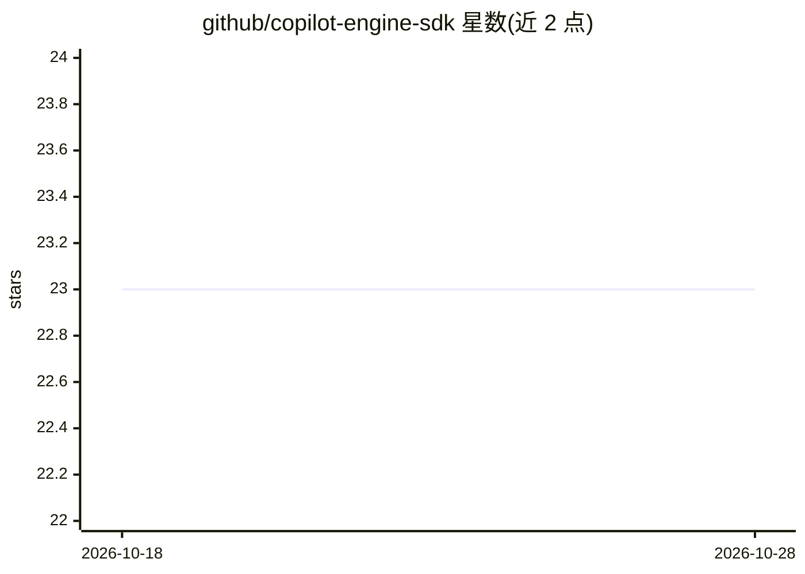

# github/copilot-engine-sdk

⭐ 23 · TypeScript · MIT · 推送 2026-09-10 · [GitHub](https://github.com/github/copilot-engine-sdk) · 组织维护

**GitHub Copilot agent 平台的引擎构建 SDK**

面向在 GitHub Copilot agent 平台上构建引擎（engine）的 TypeScript SDK：提供 PlatformClient 用于向平台 API 发送助手消息、工具执行、进度等结构化事件；带凭据安全处理的 Git 工具（clone/commit/push）；暴露 report_progress 与 reply_to_comment 工具的 MCP 服务器；MCP 代理发现；以及模拟平台 API 的本地测试 CLI（Go 构建）。README 声明该库仅供内部集成使用，不是受支持的集成路径或已发布产品。

## 筛选速览

| 维度 | 判定 | 备注 |
|---|---|---|
| AI 角色 | `ai-ecosystem` | LLM/agent 周边工具 |
| 许可风险 | `permissive` | MIT |
| 部署形态 | `library` | 以包/库形式分发 |
| 模型依赖 | — | README 未给出锁定关系 |
| 硬件要求 | — | 无带数字的原话,不猜 |
| 安装摩擦 | `low` | 无编译、无系统依赖或容器化 |
| 成熟度 | `idea` | |

## 能力要点

- PlatformClient 发送结构化平台事件（消息/工具执行/进度/历史）
- 内置 MCP Server（report_progress、reply_to_comment）与 MCP Proxy 发现
- 凭据经 http.extraHeader 传递的 Git 操作工具
- CLI 模拟平台 API 供本地测试引擎

## 适用场景

- 为 Copilot agent 平台开发自定义引擎
- 在本地用 mock 平台 API 调试引擎逻辑
- 通过 MCP 工具实现 PR 进度更新与评论回复

## 场景标签

`Agent 框架` · 领域:Agent 开发

## 证据(README 行号)

> L5: SDK for building engines on the GitHub Copilot agent platform.
> L9: The Copilot Engine SDK provides everything you need to build an engine that runs on the GitHub Copilot agent platfor
> L104: The SDK includes an MCP server that can be used with any LLM SDK that supports the Model Context Protocol.

## 星数曲线

2026-10-18 23 → 2026-10-28 23（+0）

---
*卡片 v1 · prompt 1.4 · 生成 2026-10-27 · 置信度 high · 依据 README sha `857e9cc17c79` · [字段定义](../../DATASET.md)*
