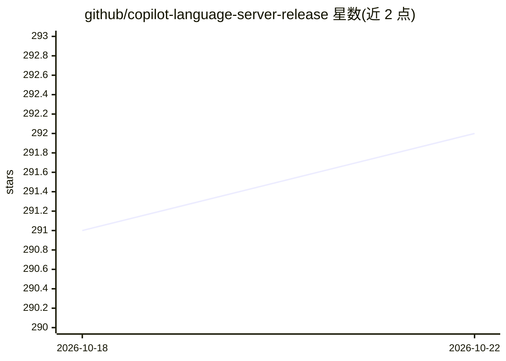

# github/copilot-language-server-release

⭐ 292 · MIT · 推送 2026-10-22 · [GitHub](https://github.com/github/copilot-language-server-release) · [官网](https://www.npmjs.com/package/@github/copilot-language-server) · 组织维护

**让任意编辑器/IDE 经 LSP 接入 GitHub Copilot 的语言服务器**

GitHub 官方发布的 Copilot 语言服务器，以 npm 包与平台专属二进制（作为可选依赖分发）形式提供，使编辑器或 IDE 通过 LSP（JSON-RPC over stdio / Node IPC）集成 GitHub Copilot 的行内补全、Next Edit 建议与统一建议接口。覆盖初始化、配置同步、用户码设备授权登录、状态通知等流程，并含自定义消息（didShowCompletion、copilotSuggest 等）。另以预览形态支持 Agent Client Protocol，可接入 JetBrains AI Assistant、Zed 等 ACP 兼容编辑器。面向编辑器/插件开发者。

## 筛选速览

| 维度 | 判定 | 备注 |
|---|---|---|
| AI 角色 | `ai-ecosystem` | LLM/agent 周边工具 |
| 许可风险 | `permissive` | MIT |
| 部署形态 | `library` | 以包/库形式分发 |
| 模型依赖 | — | README 未给出锁定关系 |
| 硬件要求 | — | 无带数字的原话,不猜 |
| 安装摩擦 | `low` | 无编译、无系统依赖或容器化 |
| 成熟度 | `idea` | |

## 能力要点

- npm 安装，平台专属二进制作为可选依赖分发，亦可用 npx 直接运行
- 实现 LSP 行内补全、Next Edit 建议及统一建议（copilotSuggest）接口
- 设备授权流（userCode + 浏览器登录）与状态/遥测通知机制
- 预览支持 Agent Client Protocol（ACP），可接入 JetBrains AI Assistant、Zed

## 适用场景

- 为自己的编辑器/IDE 实现 GitHub Copilot 行内补全集成
- 通过 ACP 模式把 Copilot 作为 agent 接入 ACP 兼容编辑器
- 插件开发中处理 Copilot 登录、状态与建议接受遥测流程

## 场景标签

`代码生成` · 领域:编码与开发

## 证据(README 行号)

> L3: The Copilot Language Server enables any editor or IDE to integrate with GitHub
> L4: Copilot via the language server protocol.
> L14: To integrate with the Copilot Language Server, download the latest release from npm:

## 星数曲线

2026-10-18 291 → 2026-10-22 292（+1）

---
*卡片 v1 · prompt 1.4 · 生成 2026-10-22 · 置信度 high · 依据 README sha `96bfafa35d88` · [字段定义](../../DATASET.md)*
