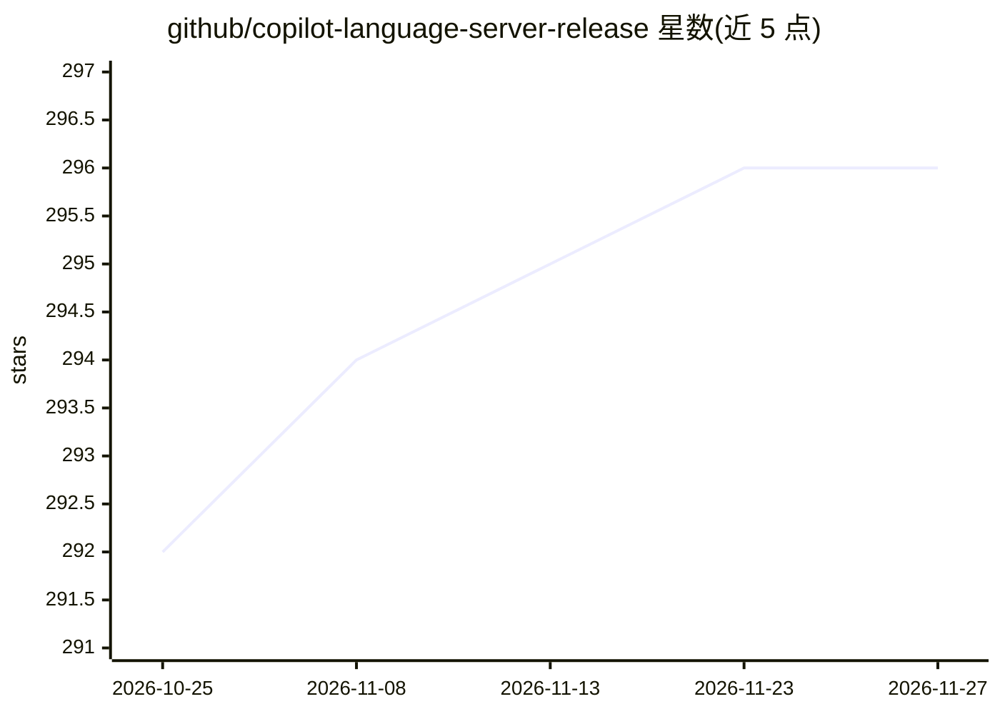

# github/copilot-language-server-release

⭐ 296 · MIT · 推送 2026-11-26 · [GitHub](https://github.com/github/copilot-language-server-release) · [官网](https://www.npmjs.com/package/@github/copilot-language-server) · 组织维护

**让任意编辑器/IDE 通过 LSP 接入 GitHub Copilot 的语言服务器**

以 npm 包发布的 Language Server，通过 LSP（JSON-RPC 2.0，stdio/Node IPC 通信）向编辑器客户端提供 Copilot 内联补全、下一编辑建议、统一建议等能力；另支持 Agent Client Protocol 以对接 JetBrains Air、JetBrains AI Assistant、Zed 等客户端。README 定义了初始化、配置同步、文档同步、状态通知、设备码登录认证等协议流程，并给出大量自定义消息。面向需要自行集成 Copilot 的编辑器/IDE 开发者；本身不含模型，需 GitHub Copilot 账号认证后使用。

## 筛选速览

| 维度 | 判定 | 备注 |
|---|---|---|
| AI 角色 | `ai-ecosystem` | LLM/agent 周边工具 |
| 许可风险 | `permissive` | MIT |
| 部署形态 | `library` | 以包/库形式分发 |
| 模型依赖 | — | README 未给出锁定关系 |
| 硬件要求 | — | 无带数字的原话,不猜 |
| 安装摩擦 | `low` | 无编译、无系统依赖或容器化 |
| 成熟度 | — | 结构信号不足 |

## 能力要点

- 通过 LSP（stdio/--node-ipc）向任意编辑器提供内联补全
- 支持 Agent Client Protocol 对接 JetBrains Air、Zed 等客户端
- textDocument/copilotInlineEdit 下一编辑建议与 copilotSuggest 统一建议接口
- signIn 设备码流程完成 GitHub 认证

## 适用场景

- 为自己的编辑器/IDE 集成 GitHub Copilot 补全
- 为 ACP 兼容客户端注册 Copilot 作为自定义 agent
- 实现 LSP 客户端时对接补全与编辑建议协议

## 场景标签

 · 领域:开发工具/编辑器集成

## 证据(README 行号)

> L3: The Copilot Language Server enables any editor or IDE to integrate with GitHub
> L97: The Language Server Protocol (LSP) is used to communicate with
> L53: The Copilot Language Server also supports the Agent Client Protocol (ACP),

## 星数曲线

2026-10-25 292 → 2026-11-27 296（+4）

---
*卡片 v1 · prompt 1.4 · 生成 2026-11-25 · 置信度 high · 依据 README sha `1ceda89baaf2` · [字段定义](../../DATASET.md)*
