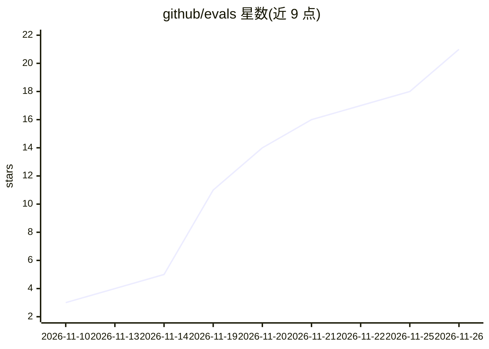

# github/evals

⭐ 21 · NOASSERTION · 推送 2026-11-21 · [GitHub](https://github.com/github/evals) · 组织维护

**为 Copilot 定制（技能/Agent/MCP 工具）创建与运行可复现评测的插件**

GitHub 官方的 Copilot 评测插件（Preview）：把任务转化为可重复的 eval，测试用户自己的 Copilot 技能、自定义 agent 与 MCP 工具，并保存结果以便修改后对比。包含六个技能（create/review/improve/run/compare/setup）、`/eval` CLI 命令、Evals Canvas 可视化面板、15 工具的 MCP server 与三个自动化蓝图。运行依赖本地 eval runner 及 Node.js、Copilot CLI 等依赖，评测会执行代码并产生 token/credit 费用。源码以 GitHub Limited Use Source License 发布，由 GitHub Copilot Evals 团队维护。

## 筛选速览

| 维度 | 判定 | 备注 |
|---|---|---|
| AI 角色 | `ai-ecosystem` | LLM/agent 周边工具 |
| 许可风险 | `none` | NOASSERTION |
| 部署形态 | `None` |  |
| 模型依赖 | — | README 未给出锁定关系 |
| 硬件要求 | — | 无带数字的原话,不猜 |
| 安装摩擦 | `low` | 无编译、无系统依赖或容器化 |
| 成熟度 | `idea` | |

## 能力要点

- 六个自然语言可调用的 eval 技能：创建、审查、改进、运行、对比、配置
- 内置 15 工具的 copilot-evals MCP server，兼容不支持 Agent Plugins 的独立 MCP 客户端
- Evals Canvas 面板浏览资产、起草 eval、查看保存的运行报告
- 保存的运行结果写入项目 .copilot\evals\results，支持跨修改对比

## 适用场景

- 为自己编写的 Copilot skill 建立可重复的测试并在改动后对比效果
- 为自定义 agent 增加 failure case 并保存修订版 eval
- 检查 MCP 工具输出是否符合预期（如 release notes 只含已完成工作）

## 场景标签

`模型评测` · 领域:评测与运维

## 证据(README 行号)

> L3: Create, run and compare tests for your GitHub Copilot skills, custom agents and
> L15: |MCP server|15-tool Model Context Protocol server (`copilot-evals` via `mcp.json`) bundled with the plugin|

## 星数曲线

2026-11-10 3 → 2026-11-26 21（+18）

---
*卡片 v1 · prompt 1.4 · 生成 2026-11-19 · 置信度 high · 依据 README sha `6c3db19a9bae` · [字段定义](../../DATASET.md)*
