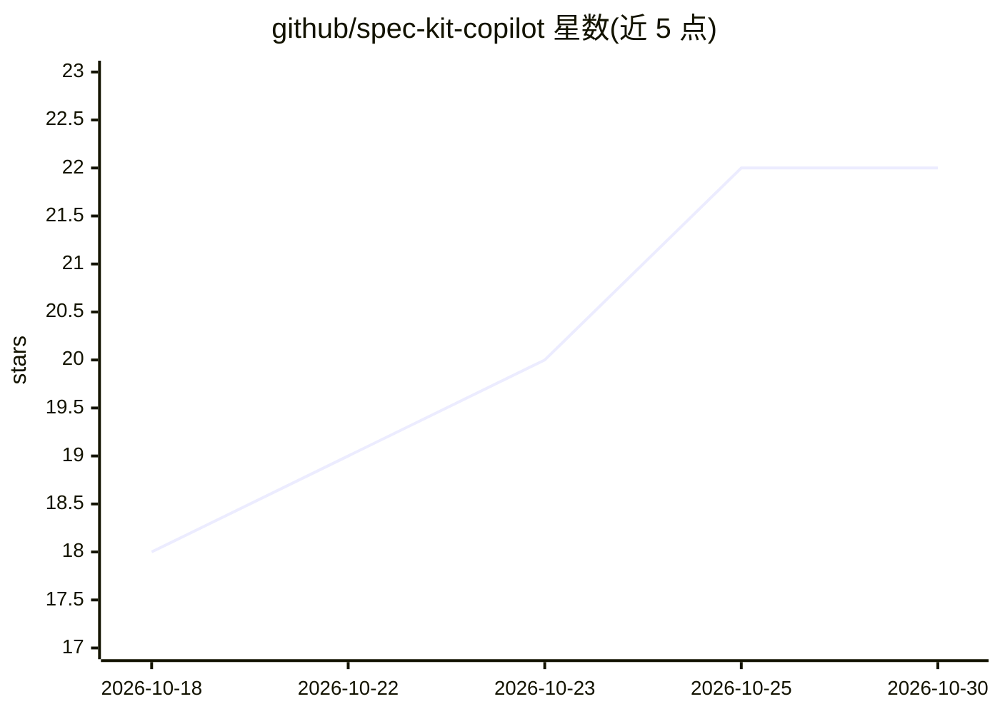

# github/spec-kit-copilot

⭐ 22 · JavaScript · MIT · 推送 2026-10-28 · [GitHub](https://github.com/github/spec-kit-copilot) · [官网](https://github.com/github/spec-kit) · 组织维护

**面向 GitHub Copilot 的 Spec Kit 集成插件集**

GitHub 官方维护的配套仓库，为 Spec Kit（规格驱动开发工具链）提供 Copilot 原生集成：一个核心技能插件（以 SKILL.md 形式教 Copilot 何时、如何调用 specify CLI 的各子命令）、四个 Copilot App 侧面板画布插件（assess/bugfix/SDD/Wizard 的可视化流程面板），以及四个由 specify CLI 消费的 Spec Kit 预设。插件通过 copilot plugin 市场命令独立安装，要求 Copilot CLI 与 PATH 上的 specify CLI（最低版本门槛随技能不同）。部分预设与 Designer 画布尚在开发中、未发布。

## 筛选速览

| 维度 | 判定 | 备注 |
|---|---|---|
| AI 角色 | `ai-ecosystem` | LLM/agent 周边工具 |
| 许可风险 | `permissive` | MIT |
| 部署形态 | `library` | 以包/库形式分发 |
| 模型依赖 | — | README 未给出锁定关系 |
| 硬件要求 | — | 无带数字的原话,不猜 |
| 安装摩擦 | `low` | 无编译、无系统依赖或容器化 |
| 成熟度 | `idea` | |

## 能力要点

- 核心技能插件以 SKILL.md 包装 specify 各命令组，Copilot 按自然语言自动选用
- 四个 Copilot App 画布插件提供 SDD/评估/修复等流程的可视化面板
- 四个 Copilot 定制 Spec Kit 预设由 specify preset add 消费
- 插件经 copilot plugin marketplace 独立安装与版本化

## 适用场景

- 在 Copilot CLI/App 中用自然语言驱动 Spec Kit 的规格驱动开发流程
- 通过侧面板画布可视化跟踪评估、修复与 SDD 流水线
- 为 Copilot 环境定制 Spec Kit 预设基线

## 场景标签

`编码 Agent` · 领域:编码与开发

## 证据(README 行号)

> L6: This repository hosts Copilot-specific integrations and Spec Kit components tailored
> L75: `spec-kit-copilot` gives Copilot focused skills—one per `specify` command group—so
> L194: Just talk to Copilot in natural language; it selects the matching skill and runs the

## 星数曲线

2026-10-18 18 → 2026-10-30 22（+4）

---
*卡片 v1 · prompt 1.4 · 生成 2026-10-27 · 置信度 mid · 依据 README sha `78569e9cb30e` · [字段定义](../../DATASET.md)*
