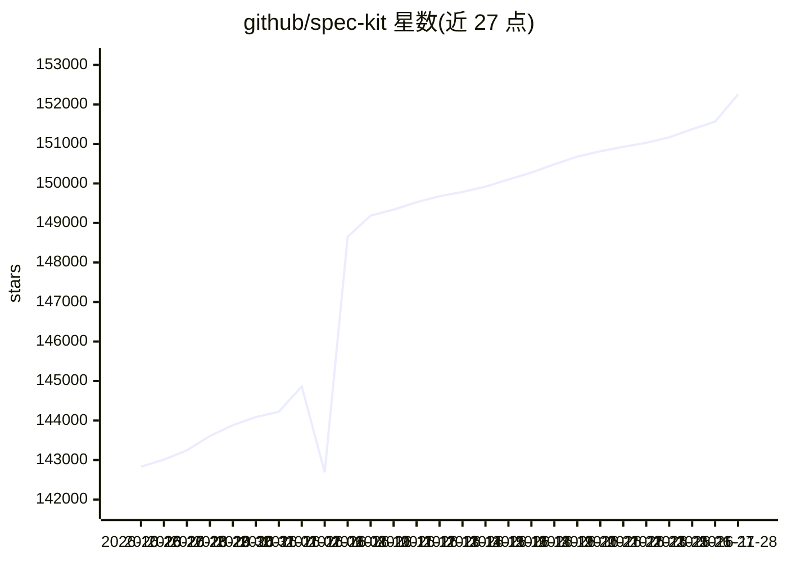

# github/spec-kit

⭐ 152,253 · Python · MIT · 推送 2026-11-26 · [GitHub](https://github.com/github/spec-kit) · [官网](https://github.github.com/spec-kit/) · 组织维护 · 中文 README

**给 AI 编码代理提供结构化流程与模板的开发工具包**

Spec Kit 是一个开源工具包，为 AI 编码代理提供结构化流程、可复用模板与文档化产出。内置三条流程入口：规格驱动开发（SDD）、Bug 修复扩展、想法评估扩展，均可通过 specify CLI 安装扩展并代理内的斜杠命令逐步执行；支持扩展、预设、工作流、目录、捆绑包等机制来自定义或自带流程。需 Python 3.11+、uv 及受支持的 AI 编码代理，MIT 许可，提供多语言文档。

## 筛选速览

| 维度 | 判定 | 备注 |
|---|---|---|
| AI 角色 | `ai-ecosystem` | LLM/agent 周边工具 |
| 许可风险 | `permissive` | MIT |
| 部署形态 | `None` |  |
| 模型依赖 | — | README 未给出锁定关系 |
| 硬件要求 | — | 无带数字的原话,不猜 |
| 安装摩擦 | `low` | 无编译、无系统依赖或容器化 |
| 成熟度 | — | 结构信号不足 |

## 动量与使用信号

- 维护:`active` — 距上次 push 1.4 天,年发版 100,312 位贡献者
- 涨星:近 1 天 **+164**(自 20261016 起算)
- 安装:github 包 `release-assets` 月下载无数据
- 平台:WINDOWS / MACOS / LINUX · 协议:—

## 能力要点

- specify CLI 安装命令与项目初始化（uv tool install specify-cli）
- SDD 流程：constitution/specify/plan/tasks/implement/converge 命令链
- Bug 修复与想法评估作为按需安装的捆绑扩展
- 扩展、预设、工作流、目录、私有目录认证等组合机制

## 适用场景

- 用规格驱动流程让编码代理从规格生成计划与代码
- 对已有项目的 Bug 做原因评估、修复与验证
- 在写代码前用证据评估一个想法是否值得投入
- 为团队定制符合组织或监管标准的流程

## 场景标签

`编码 Agent` · 领域:编码与开发

## 证据(README 行号)

> L15: Spec Kit is an open source toolkit that gives AI coding agents structured
> L38: |Connect to or switch between coding agents|Integration|

## 星数曲线

2026-10-26 142,832 → 2026-11-28 152,253（+9,421）

---
*卡片 v1 · prompt 1.4 · 生成 2026-11-22 · 置信度 high · 依据 README sha `92e41fbca385` · [字段定义](../../DATASET.md)*
