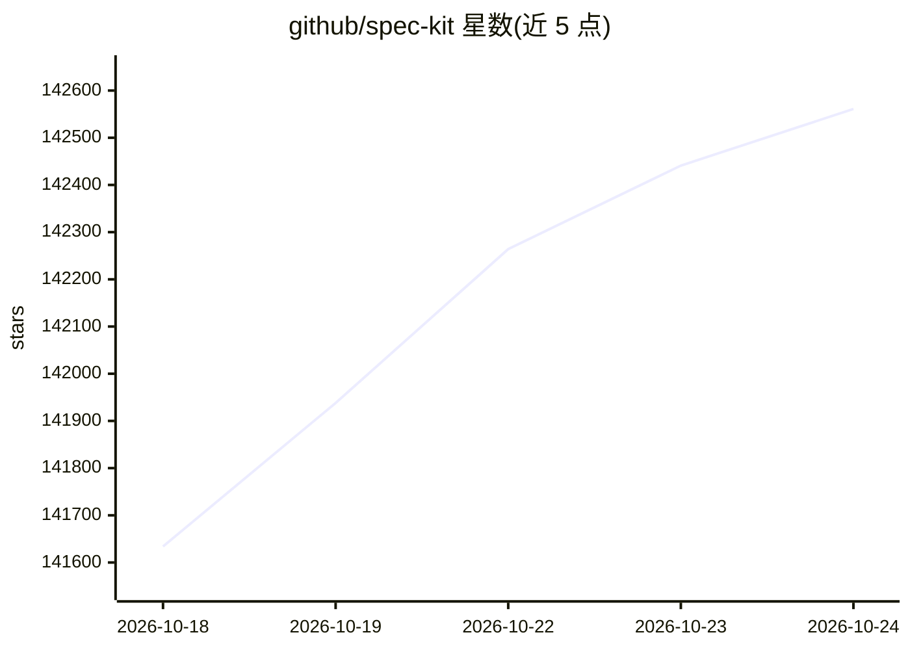

# github/spec-kit

⭐ 142,561 · Python · MIT · 推送 2026-10-23 · [GitHub](https://github.com/github/spec-kit) · [官网](https://github.github.com/spec-kit/) · 组织维护 · 中文 README

**给 AI 编码 agent 提供结构化流程与模板的工具包**

开源工具包，为 AI 编码 agent 提供结构化流程、可复用模板与产出文档。内置 Spec-Driven Development（constitution → specify → plan → tasks → implement → converge），另提供可选扩展：bug 修复（assess/fix/test，产出 verified/partial/failed 结论）与想法评估（五步流程，产出 go/clarify/kill 决策）。通过 Integration 机制连接或切换编码 agent，支持扩展、preset、workflow、bundle 与社区/私有目录。使用需 Python 3.11+ 与 uv，以 specify-cli 安装，在 Linux/macOS/Windows 运行。

## 筛选速览

| 维度 | 判定 | 备注 |
|---|---|---|
| AI 角色 | `ai-ecosystem` | LLM/agent 周边工具 |
| 许可风险 | `permissive` | MIT |
| 部署形态 | `library` | 以包/库形式分发 |
| 模型依赖 | — | README 未给出锁定关系 |
| 硬件要求 | — | 无带数字的原话,不猜 |
| 安装摩擦 | `low` | 无编译、无系统依赖或容器化 |
| 成熟度 | — | 结构信号不足 |

## 动量与使用信号

- 维护:`active` — 距上次 push 1.4 天,年发版 100,312 位贡献者
- 涨星:近 1 天 **+164**(自 20261016 起算)
- 安装:github 包 `release-assets` 月下载无数据
- 平台:WINDOWS / MACOS / LINUX · 协议:—

## 能力要点

- 内置 SDD 流程：specify → plan → tasks → implement → converge
- 可选扩展：bug 修复与证据驱动的想法评估
- 扩展/preset/workflow/bundle 与社区目录的组件化机制
- 通过 Integration 连接或切换不同 AI 编码 agent

## 适用场景

- 在写代码前先让 agent 生成规范、计划与任务清单
- 结构化地诊断、修复并验证 bug
- 评估一个想法是否值得投入，留下 go/kill 决策记录

## 场景标签

`Agent 框架` `提示工程` · 领域:Agent 开发

## 证据(README 行号)

> L15: Spec Kit is an open source toolkit that gives AI coding agents structured
> L65: and a supported AI coding agent on Linux, macOS, or Windows.

## 星数曲线

2026-10-18 141,634 → 2026-10-24 142,561（+927）

---
*卡片 v1 · prompt 1.4 · 生成 2026-10-20 · 置信度 mid · 依据 README sha `6ac2b5412b02` · [字段定义](../../DATASET.md)*
