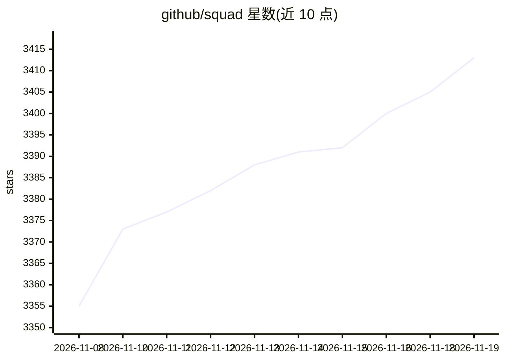

# github/squad

⭐ 3,413 · TypeScript · MIT · 推送 2026-11-18 · [GitHub](https://github.com/github/squad) · [官网](https://github.github.io/squad/) · 组织维护

**人主导的 AI 编码 agent 团队 CLI：为项目组建多专家智能体**

基于 GitHub Copilot 等编码 agent 客户端的 CLI 工具：通过 squad init 在仓库中生成由前端、后端、测试、负责人等角色组成的持久化 agent 团队（以文件形式存在于 .squad/ 目录），各成员独立上下文、共享决策记录，跨会话保留状态。支持 Claude Code、Kiro、OpenCode、Cursor、Codex 等多种宿主，提供 17 个命令覆盖初始化、升级、issue 自动分诊（Ralph 轮询模式）、状态导出与仪表盘。另提供 .NET NuGet 包将团队注册为 Agent Framework agent。定位为人的生产力工具，人保留优先级与审批权。

## 筛选速览

| 维度 | 判定 | 备注 |
|---|---|---|
| AI 角色 | `ai-ecosystem` | LLM/agent 周边工具 |
| 许可风险 | `permissive` | MIT |
| 部署形态 | `library` | 以包/库形式分发 |
| 模型依赖 | — | README 未给出锁定关系 |
| 硬件要求 | — | 无带数字的原话,不猜 |
| 安装摩擦 | `medium` | 含编译或系统依赖之一 |
| 成熟度 | — | 结构信号不足 |

## 能力要点

- 以文件形式持久化的多角色 agent 团队，跨会话保留状态与决策
- 同一团队可投影到 Copilot、Claude Code、Cursor、Codex 等多种客户端
- Ralph watch 模式轮询 issue 并自动分诊、派发 agent 执行
- 17 个 CLI 命令，含升级、状态外置、上下文压缩与本地仪表盘

## 适用场景

- 在仓库中组建并管理多角色 AI 编码团队
- 自动轮询 GitHub issue 并分诊给 agent 处理
- 跨多个 AI 编码客户端复用同一团队配置

## 场景标签

`多智能体` `编码 Agent` · 领域:Agent 开发

## 证据(README 行号)

> L13: Squad gives you a human-directed AI development team through GitHub Copilot. Describe what you're building. Get a t
> L136: Squad is not tied to one client. Add `--client` to project the same team and the `squad_state` backend into Claude

## 星数曲线

2026-11-08 3,355 → 2026-11-19 3,413（+58）

---
*卡片 v1 · prompt 1.4 · 生成 2026-11-17 · 置信度 high · 依据 README sha `bd3ce59129eb` · [字段定义](../../DATASET.md)*
