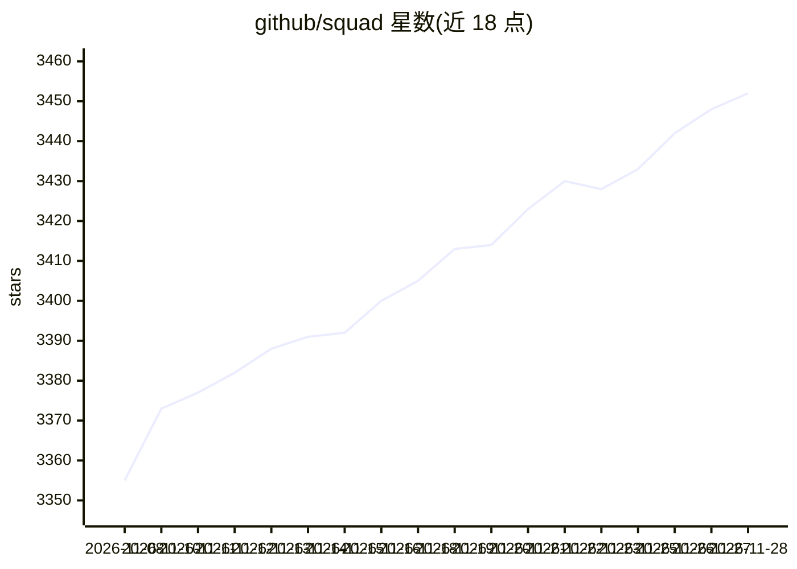

# github/squad

⭐ 3,452 · TypeScript · MIT · 推送 2026-11-25 · [GitHub](https://github.com/github/squad) · [官网](https://github.github.io/squad/) · 组织维护

**开发者工具：为任意项目组建人主导的 AI agent 团队**

以 CLI 形式安装的编排工具，通过 GitHub Copilot 及多种 AI 客户端为项目提供一组专家 agent：用户描述要构建的内容，Squad 在仓库内生成 `.squad/` 团队配置并跨会话保留上下文；优先级、审批与最终修改仍由用户掌控。支持 npm、Homebrew、WinGet 三种安装方式，可通过 `squad init --client` 适配 7 种客户端，各客户端共享同一团队配置。使用需自备已安装的 AI 客户端与模型访问权限。

## 筛选速览

| 维度 | 判定 | 备注 |
|---|---|---|
| AI 角色 | `ai-ecosystem` | LLM/agent 周边工具 |
| 许可风险 | `permissive` | MIT |
| 部署形态 | `library` | 以包/库形式分发 |
| 模型依赖 | — | README 未给出锁定关系 |
| 硬件要求 | — | 无带数字的原话,不猜 |
| 安装摩擦 | `low` | 无编译、无系统依赖或容器化 |
| 成熟度 | — | 结构信号不足 |

## 能力要点

- 通过 `squad init` 适配 7 种 AI 客户端，共享一个 `.squad/` 团队
- 团队配置驻留仓库内并跨会话保留上下文
- 支持 npm / Homebrew / WinGet 安装
- 变更需经用户审查确认后接受

## 适用场景

- 在现有 Git 仓库中为项目搭建多 agent 协作团队
- 在 Copilot CLI 或 VS Code Copilot Chat 中以 squad agent 方式工作
- 多客户端场景下共享同一套团队配置

## 场景标签

`多智能体` `编码 Agent` `Agent 框架` · 领域:Agent 开发

## 证据(README 行号)

> L5: **Human-led AI agent teams for any project.**
> L7: Squad gives you a team of specialists through GitHub Copilot and other AI clients. Describe what you're building; yo
> L38: For GitHub Copilot (CLI or VS Code), run `squad init`. To choose a client explicitly, run one of:

## 星数曲线

2026-11-08 3,355 → 2026-11-28 3,452（+97）

---
*卡片 v1 · prompt 1.4 · 生成 2026-11-26 · 置信度 high · 依据 README sha `a1f402139477` · [字段定义](../../DATASET.md)*
