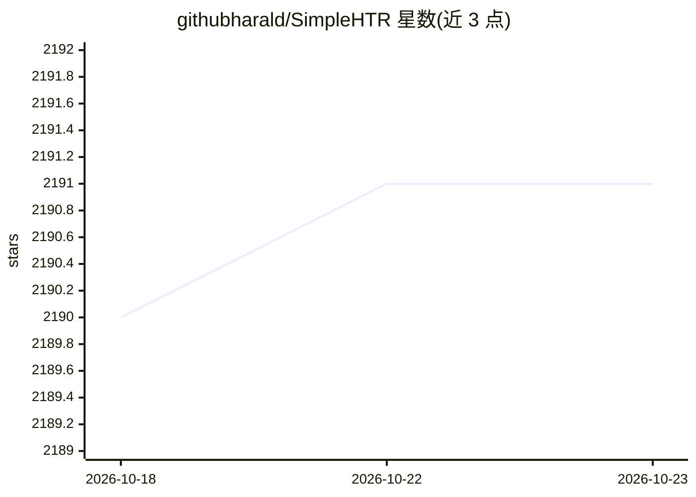

# githubharald/SimpleHTR

⭐ 2,191 · Python · MIT · 推送 2026-06-25 · [GitHub](https://github.com/githubharald/SimpleHTR) · [官网](https://harald-scheidl.medium.com/2326a3487cd5) · 个人维护

**基于 TensorFlow 的手写文本识别系统，输入词/行图像输出文本**

用 TensorFlow 实现并已在 IAM 离线手写数据集上训练的 HTR 系统：输入单个词或整行文本的图像，输出识别的文字及置信度。模型为 5 层 CNN + 2 层 LSTM + CTC 损失/解码，支持 bestpath、beamsearch、wordbeamsearch 三种解码器，后者以词典约束词形。提供预训练模型下载后直接运行 python main.py 推理，也支持在 IAM 数据集上自行训练（可选 LMDB 加速读取）。验证集 3/4 的词被正确识别，字符错误率约 10%。面向需要手写识别能力的开发者与研究者。

## 筛选速览

| 维度 | 判定 | 备注 |
|---|---|---|
| AI 角色 | `ai-native` | 本体是模型或模型工具 |
| 许可风险 | `permissive` | MIT |
| 部署形态 | `library` | 以包/库形式分发 |
| 模型依赖 | — | README 未给出锁定关系 |
| 硬件要求 | — | 无带数字的原话,不猜 |
| 安装摩擦 | `low` | 无编译、无系统依赖或容器化 |
| 成熟度 | — | 结构信号不足 |

## 能力要点

- 词级与行级（多词）图像输入的文本识别
- 5 CNN + 2 LSTM + CTC 架构，三种解码器可选
- 提供预训练模型，python main.py 即可推理
- 支持在 IAM 数据集上训练，LMDB 加速图像读取

## 适用场景

- 对扫描的手写词或文本行图像做文字识别
- 在 IAM 数据集上复现或改进 HTR 模型
- 对比 CTC 三种解码器（含词典约束的 word beam search）效果

## 场景标签

`OCR` · 领域:感知与多模态

## 证据(README 行号)

> L9: Handwritten Text Recognition (HTR) system implemented with TensorFlow (TF) and trained on the IAM off-line HTR datas
> L10: The model takes **images of single words or text lines (multiple words) as input** and **outputs the recognized tex

## 星数曲线

2026-10-18 2,190 → 2026-10-23 2,191（+1）

---
*卡片 v1 · prompt 1.4 · 生成 2026-10-21 · 置信度 mid · 依据 README sha `6fd74b6f0145` · [字段定义](../../DATASET.md)*
