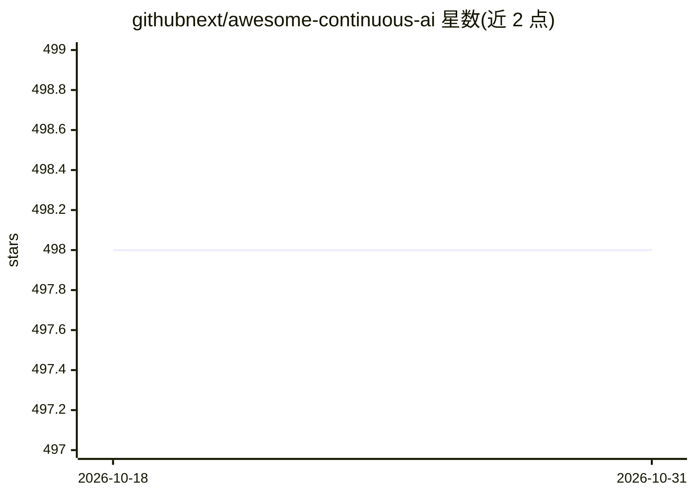

# githubnext/awesome-continuous-ai

⭐ 498 · MIT · 推送 2025-11-16 · [GitHub](https://github.com/githubnext/awesome-continuous-ai) · 组织维护

**Continuous AI 清单：收录用 AI 自动化软件协作的 Actions 与框架**

GitHub Next 维护的 awesome 清单，围绕"Continuous AI"概念——用自动化 AI 支持软件协作流程，对齐 CI/CD。按 12 个类别收录工具与项目：持续分诊（issue 标注/去重/陈旧 issue 处理）、持续文档生成、AI 代码审查与优化、测试改进、团队沟通、社区治理、对齐测试与持续评测等；另列平台（GitHub Actions/GitHub Models）、通用 Agent 框架（Copilot Coding Agent/Claude Code 等）及 YAML/Shell/Python/JS/Markdown 多语言编程框架条目。声明收录不代表推荐，部分链接可能过时或为商业产品。

## 筛选速览

| 维度 | 判定 | 备注 |
|---|---|---|
| AI 角色 | `ai-knowledge` | 知识聚合/清单类 |
| 许可风险 | `permissive` | MIT |
| 部署形态 | `None` |  |
| 模型依赖 | — | README 未给出锁定关系 |
| 硬件要求 | — | 无带数字的原话,不猜 |
| 安装摩擦 | `low` | 无编译、无系统依赖或容器化 |
| 成熟度 | — | 结构信号不足 |

## 能力要点

- 按 12 个类别组织 Continuous AI 工具与框架条目
- 覆盖 issue 分诊、文档生成、代码审查、测试改进等协作环节
- 单列 GitHub Actions/GitHub Models 平台与通用 Agent 框架章节
- 列出 YAML/Shell/Python/JavaScript/Markdown 五类 LLM 编程框架条目

## 适用场景

- 为仓库寻找自动化 issue 分诊或文档生成的 GitHub Action
- 了解 CI/CD 流程中可接入的 AI 工具生态
- 挑选 Agent 框架或 LLM 编程库来构建自动化工作流

## 场景标签

`精选清单` · 领域:学习与行业

## 证据(README 行号)

> L1: # Awesome Continuous AI
> L3: **Continuous AI is any use of automated AI to support software collaboration on any platform.** The term aligns with
> L7: ## Categories

## 星数曲线

2026-10-18 498 → 2026-10-31 498（+0）

---
*卡片 v1 · prompt 1.4 · 生成 2026-10-21 · 置信度 high · 依据 README sha `e4ff43a56b25` · [字段定义](../../DATASET.md)*
