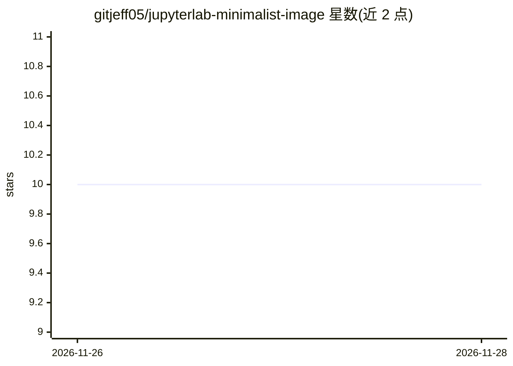

# gitjeff05/jupyterlab-minimalist-image

⭐ 10 · Dockerfile · MIT · 推送 2026-03-19 · [GitHub](https://github.com/gitjeff05/jupyterlab-minimalist-image) · 个人维护

**面向数据科学工作者的精简 JupyterLab Docker 镜像**

基于官方 Python Docker 镜像构建的 JupyterLab 容器镜像，预装 numpy、pandas、scipy、matplotlib、seaborn、bokeh、scikit-learn、sympy 等科学计算栈，采用多阶段构建保持 7 层、820 MB 体积，默认非 root 用户运行。提供 basic、astropy、pytorch（CPU）、jupyter-ai 等变体，其中 jupyter-ai 变体通过运行时环境变量注入 API key 启用聊天侧边栏与 %%ai 魔法命令。README 声明项目处于实验阶段。

## 筛选速览

| 维度 | 判定 | 备注 |
|---|---|---|
| AI 角色 | `ai-enhanced` | 去掉 AI 部分产品仍成立 |
| 许可风险 | `permissive` | MIT |
| 部署形态 | `self-host` | docker 或自建部署 |
| 模型依赖 | — | README 未给出锁定关系 |
| 硬件要求 | — | 无带数字的原话,不猜 |
| 安装摩擦 | `low` | 无编译、无系统依赖或容器化 |
| 成熟度 | `idea` | |

## 能力要点

- 多阶段构建：builder 阶段装包到 /venv，final 阶段仅复制 venv，共 7 层 820 MB
- 仅用 pip 安装，不含 conda、JupyterHub、TeX Live，单一 ~28 行 Dockerfile
- 可选 jupyter-ai 变体：Jupyternaut 聊天侧边栏与 %%ai 单元魔法，API key 运行时注入
- 默认非 root 用户，镜像内不嵌入密钥

## 适用场景

- 快速获得开箱即用的 Python 数据科学 JupyterLab 环境
- 挂载本地项目目录在容器中做数据分析与机器学习实验
- 以精简镜像为基础扩展自己的依赖并重建

## 场景标签

 · 领域:开发工具/容器化环境

## 证据(README 行号)

> L1: # Minimalist JupyterLab Docker Image
> L9: - **AI-ready** — optional jupyter-ai variant with chat sidebar and `%%ai` cell magic; bring your own API key
> L28: |`jupyter-ai/`|Full scientific stack + jupyter-ai chat sidebar and `%%ai` cell magic. API key injected at runtime v

## 星数曲线

2026-11-26 10 → 2026-11-28 10（+0）

---
*卡片 v1 · prompt 1.4 · 生成 2026-11-26 · 置信度 high · 依据 README sha `bc05c595dcf0` · [字段定义](../../DATASET.md)*
