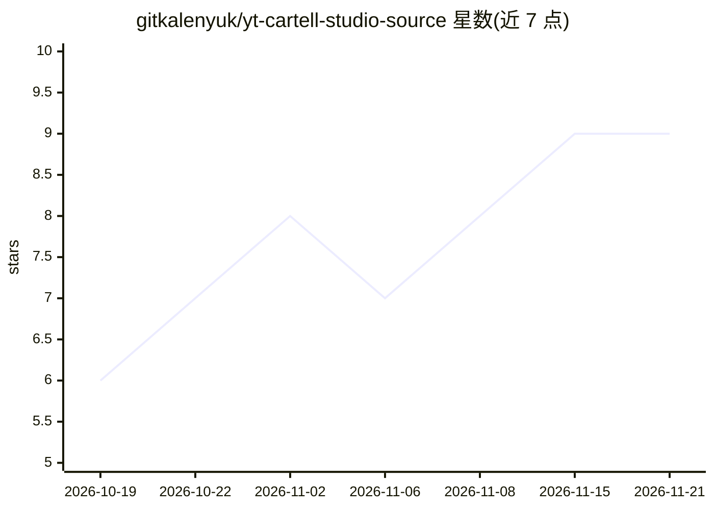

# gitkalenyuk/yt-cartell-studio-source

⭐ 9 · Go · MIT · 推送 2026-10-12 · [GitHub](https://github.com/gitkalenyuk/yt-cartell-studio-source) · [官网](https://gitkalenyuk.github.io/yt-cartell-studio/) · 个人维护

**开源桌面 AI 视频工作室：故事到成片一条龙**

用 Go + Gio 编写的桌面程序（单 exe，Windows/macOS/Linux），把故事文本走完五步流程：剧本 → 计划 → 分镜 → 视频与配音 → 剪辑，输出带字幕和封面的 .mp4。支持 Autopilot 自动全流程或逐步执行；生成通过用户自有的服务与 API key（文本、图片、视频、语音），密钥仅存本地。带人物一致性、YouTube 参考重拍、时间线剪辑、封面模板、Telegram 远程控制、加密配置迁移与内置更新校验。

## 筛选速览

| 维度 | 判定 | 备注 |
|---|---|---|
| AI 角色 | `ai-native` | 本体是模型或模型工具 |
| 许可风险 | `permissive` | MIT |
| 部署形态 | `desktop` | 安装包/桌面程序 |
| 模型依赖 | local-ok | 支持本地模型 |
| 硬件要求 | — | 无带数字的原话,不猜 |
| 安装摩擦 | `high` | 编译与系统依赖俱全 |
| 成熟度 | — | 结构信号不足 |

## 能力要点

- 五步流程或 Autopilot 自动产出含字幕与封面的 .mp4
- 通过用户自有 API key 接入文本/图片/视频/语音生成服务，密钥仅存本地
- 时间线剪辑：23 转场、12 运动效果、15 滤镜，可导出 DaVinci/Premiere/Final Cut 等工程格式
- 本地 whisper.cpp 语音识别无需 key；支持代码绘制动画场景

## 适用场景

- 把故事文本一键生成 YouTube 视频/Shorts
- 用时间线剪辑与转场、滤镜精修 AI 生成片段
- 通过 Telegram 手机远程提交项目并接收成品视频
- 参考某个 YouTube 视频重拍自己的版本

## 场景标签

`视频生成` `语音识别` `语音合成` · 领域:内容生成

## 证据(README 行号)

> L3: Відкрита десктопна студія, де історія стає відео: **історія → план → кадри → відео й озвучка →
> L12: Генерацію робиш **своїми** сервісами й ключами (текст, картинки, відео, озвучка): студія нічого не
> L74: |**Текст** (сценарій, план, промти)|будь-який OpenAI-сумісний сервер (OpenAI, OpenRouter, локальний шлюз на кшталт 

## 星数曲线

2026-10-19 6 → 2026-11-21 9（+3）

---
*卡片 v1 · prompt 1.4 · 生成 2026-11-20 · 置信度 high · 依据 README sha `bdbe59da0792` · [字段定义](../../DATASET.md)*
