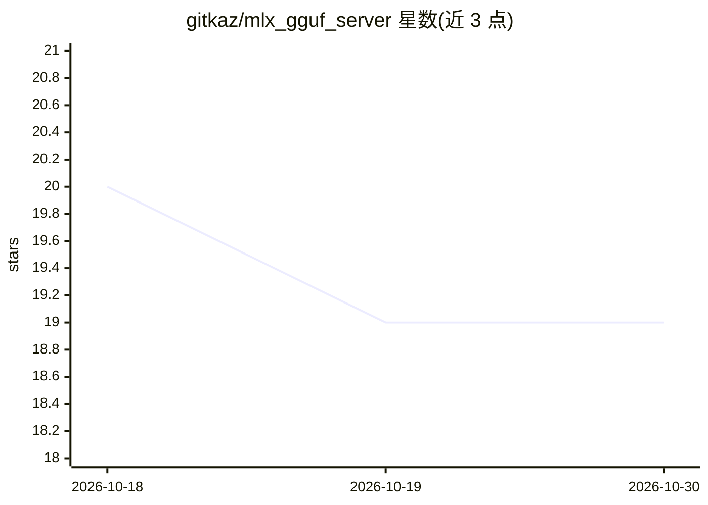

# gitkaz/mlx_gguf_server

⭐ 19 · Python · MIT · 推送 2026-04-08 · [GitHub](https://github.com/gitkaz/mlx_gguf_server) · 个人维护

**在 Apple Silicon 上同时加载多模型的 FastAPI LLM 服务器**

作者自述为学习 LLM 与 Python 的练习项目。基于 FastAPI 的本地推理服务器：通过多进程在 Apple Silicon Mac 上同时加载、卸载、切换多个 LLM，支持 MLX 格式（mlx/mlx_lm 库）与 llama.cpp 的 GGUF 格式（llama-cpp-python 库）。提供 /v1/completions、/v1/chat/completions、音频转录（Whisper，MLX 版）、LoRA adapter 加载（仅 MLX 模型）等端点，及进程/队列管理 API。安装方式为 pip 依赖加 python main.py 启动，仅限 Apple Silicon Mac 运行。

## 筛选速览

| 维度 | 判定 | 备注 |
|---|---|---|
| AI 角色 | `ai-ecosystem` | LLM/agent 周边工具 |
| 许可风险 | `permissive` | MIT |
| 部署形态 | `library` | 以包/库形式分发 |
| 模型依赖 | local-ok | 支持本地模型 |
| 硬件要求 | — | 无带数字的原话,不猜 |
| 安装摩擦 | `low` | 无编译、无系统依赖或容器化 |
| 成熟度 | — | 结构信号不足 |

## 能力要点

- 多进程同时加载多个 MLX 与 GGUF 格式模型，通过 X-Model-Id 指定目标
- 提供 /v1/completions 与 /v1/chat/completions 端点，自动套用 chat 模板
- Whisper 音频转录（--enable-whisper，需 MLX 转换的模型）
- LoRA adapter 加载，目前仅支持 MLX 模型

## 适用场景

- 在同一台 Mac 上并行服务多个本地 LLM 供应用调用
- 用 OpenAI 风格端点对接本地模型完成补全与对话
- 本地转录音频文件并查询 token 数、进程队列状态

## 场景标签

`推理引擎` `语音识别` · 领域:感知与多模态

## 证据(README 行号)

> L11: Supports both MLX format and llama.cpp(gguf) format models. The MLX format models are loaded using the `mlx` and `m
> L15: This program is using MLX framework, so run only on Apple Silicon Macs.
> L22: 3. Start the server by running `python main.py`. By default, `http://127.0.0.1:4000` will be used for service. You 

## 星数曲线

2026-10-18 20 → 2026-10-30 19（-1）

---
*卡片 v1 · prompt 1.4 · 生成 2026-10-28 · 置信度 high · 依据 README sha `69e677d808a4` · [字段定义](../../DATASET.md)*
