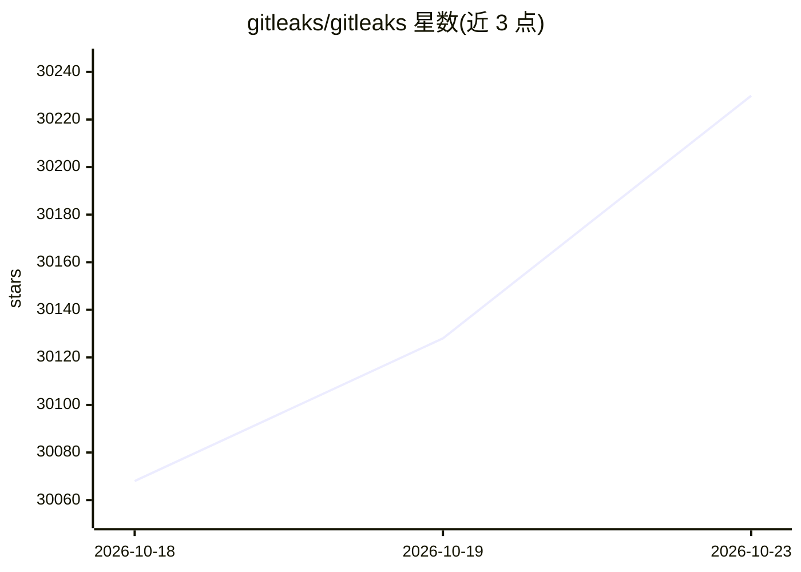

# gitleaks/gitleaks

⭐ 30,230 · Go · MIT · 推送 2026-09-30 · [GitHub](https://github.com/gitleaks/gitleaks) · [官网](https://gitleaks.io) · 个人维护

**扫描 git 仓库、目录与 stdin 中的密码/API 密钥等秘密的工具**

Go 编写的命令行工具，通过正则规则检测 git 仓库、目录文件和 stdin 输入中的硬编码秘密。提供 git/dir/stdin 三种扫描模式，支持自定义 TOML 检测规则、基线忽略旧发现、gitleaks:allow 与 .gitleaksignore 忽略机制，支持编码文本解码（percent/hex/base64）与递归归档扫描，输出 json/csv/junit/sarif 及模板自定义报告。可安装为 pre-commit 钩子或 GitHub Action。v8.19.0 起废弃 detect/protect 命令；维护者声明不再合并新功能，后续仅发布安全补丁。

## 筛选速览

| 维度 | 判定 | 备注 |
|---|---|---|
| AI 角色 | `ai-enhanced` | 去掉 AI 部分产品仍成立 |
| 许可风险 | `permissive` | MIT |
| 部署形态 | `desktop` | 安装包/桌面程序 |
| 模型依赖 | — | README 未给出锁定关系 |
| 硬件要求 | — | 无带数字的原话,不猜 |
| 安装摩擦 | `low` | 无编译、无系统依赖或容器化 |
| 成熟度 | `idea` | |

## 动量与使用信号

- 维护:`active` — 距上次 push 18.2 天,年发版 4,210 位贡献者
- 涨星:近 1 天 **+77**(自 20261016 起算)
- 下载:GitHub Release 附件 累计 79,770,546(100 个 release)
- 平台:MACOS · 协议:—

## 能力要点

- git/dir/stdin 三种扫描模式，基于正则规则引擎检测秘密
- TOML 自定义规则，v8.28.0 引入带邻近约束的复合规则
- 基线报告忽略旧发现，支持 gitleaks:allow 与 .gitleaksignore
- 内置 json/csv/junit/sarif 报告格式及 Go 模板自定义

## 适用场景

- 在 CI 中扫描仓库历史与目录里的泄漏密钥
- 配置 pre-commit 钩子在提交前拦截秘密
- 对 zip/tar 归档与编码文本做递归解码检测

## 场景标签

`网络安全` · 领域:学习与行业

## 证据(README 行号)

> L21: Gitleaks is a tool for **detecting** secrets like passwords, API keys, and tokens in git repos, files, and whatever
> L32: Gitleaks can be installed using Homebrew, Docker, or Go. Gitleaks is also available in binary form for many popular
> L90: There are three scanning modes: `git`, `dir`, and `stdin`.

## 星数曲线

2026-10-18 30,068 → 2026-10-23 30,230（+162）

---
*卡片 v1 · prompt 1.4 · 生成 2026-10-18 · 置信度 high · 依据 README sha `2417b306be18` · [字段定义](../../DATASET.md)*
