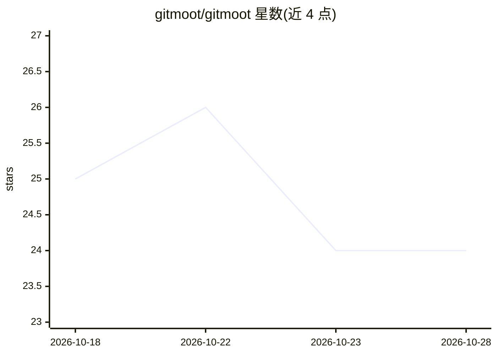

# gitmoot/gitmoot

⭐ 24 · Go · Apache-2.0 · 推送 2026-10-27 · [GitHub](https://github.com/gitmoot/gitmoot) · [官网](https://gitmoot.io/) · 组织维护

**本地优先的多 agent 协调层：用 GitHub PR 工作流驱动 agent 运行时**

以单个静态二进制加本地 SQLite 运行在本机，把 GitHub 仓库与 PR 作为人机共享协作面：PR 评论转为 agent 任务，agent 产出回流为分支、提交与评审。核心机制包括跨运行时的子 agent 委派 DAG（Codex/Claude Code/Kimi Code/omp/Shell 适配同一契约）、锁与预算、崩溃恢复的无人值守运行，以及 YAML 定义可复跑的 Pipelines 与可离线复验的 proof 回执。限制：仅本地运行，无云端托管面，GitHub 评论以 gh 用户身份发出。

## 筛选速览

| 维度 | 判定 | 备注 |
|---|---|---|
| AI 角色 | `ai-ecosystem` | LLM/agent 周边工具 |
| 许可风险 | `permissive` | Apache-2.0 |
| 部署形态 | `None` |  |
| 模型依赖 | — | README 未给出锁定关系 |
| 硬件要求 | — | 无带数字的原话,不猜 |
| 安装摩擦 | `low` | 无编译、无系统依赖或容器化 |
| 成熟度 | — | 结构信号不足 |

## 能力要点

- 跨运行时委派 DAG：Codex/Claude Code/Kimi Code/omp/Shell 同树协作
- 单静态二进制 + 本地 SQLite，零运行时依赖，无云端控制面
- 无人值守设计：锁、token/美元预算、boot-id 崩溃恢复、优雅降级
- Pipelines 以 YAML 保存为可复跑的 agent 图，可暴露为带类型防火墙的服务 API 并生成可验证回执

## 适用场景

- 让多个 coding agent 在 GitHub PR 上协同评审、实现与验证
- 夜间无人值守跑多 agent 工作流，靠预算与崩溃回收保证不丢工作
- 用 /gitmoot 评论指令从 PR 直接调度 agent 任务

## 场景标签

`多智能体` `Agent 框架` · 领域:Agent 开发

## 证据(README 行号)

> L32: Gitmoot makes the repository and its PRs the shared surface where humans and agents work together. It runs entirely
> L86: The core primitive is a runtime-neutral Gitmoot agent. Codex, Claude Code, Kimi Code, and omp are adapters behind o

## 星数曲线

2026-10-18 25 → 2026-10-28 24（-1）

---
*卡片 v1 · prompt 1.4 · 生成 2026-10-27 · 置信度 high · 依据 README sha `26828c3354e8` · [字段定义](../../DATASET.md)*
