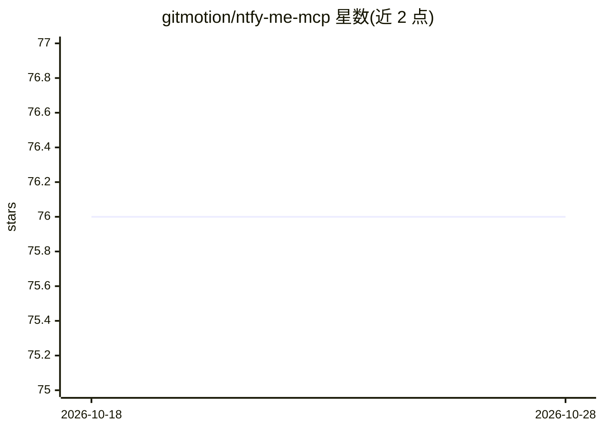

# gitmotion/ntfy-me-mcp

⭐ 76 · TypeScript · GPL-3.0 · 推送 2026-10-08 · [GitHub](https://github.com/gitmotion/ntfy-me-mcp) · [官网](https://npmjs.com/package/ntfy-me-mcp) · 个人维护

**让 AI 助手通过 ntfy 收发通知的 MCP 服务器**

TypeScript 实现的 Model Context Protocol 服务器，供 AI 助手向 ntfy.sh 公共服务或自托管 ntfy 实例发送通知、拉取并过滤缓存消息。支持主题、标题、优先级、emoji 标签、自动 URL 检测生成 view action、markdown 自动识别，以及访问令牌认证（NTFY_TOKEN）与主题/服务器覆盖的白名单控制。提供 npx、npm 全局安装、Docker（DockerHub/GHCR）与源码构建多种运行方式，附 Claude Code、Codex、Copilot CLI、OpenCode、VS Code 等客户端配置示例。需 Node.js 24 或更新版本（Docker 方式仅需 Docker）。

## 筛选速览

| 维度 | 判定 | 备注 |
|---|---|---|
| AI 角色 | `ai-ecosystem` | LLM/agent 周边工具 |
| 许可风险 | `viral` | GPL-3.0 |
| 部署形态 | `library` | 以包/库形式分发 |
| 模型依赖 | — | README 未给出锁定关系 |
| 硬件要求 | — | 无带数字的原话,不猜 |
| 安装摩擦 | `low` | 无编译、无系统依赖或容器化 |
| 成熟度 | — | 结构信号不足 |

## 能力要点

- 通过 MCP 向 ntfy.sh 或自托管 ntfy 发送/拉取通知
- 自动 URL 检测生成 view action 与智能 markdown 识别
- 访问令牌认证与主题白名单（NTFY_TOPICS_ALLOWLIST）等访问控制
- npx / npm / Docker / 源码多种安装运行方式，覆盖多种 MCP 客户端配置

## 适用场景

- AI 助手完成任务、出错或到达里程碑时给我手机/桌面推送通知
- 让 agent 在构建、部署等关键节点发 ntfy 告警
- 从自托管 ntfy 服务器拉取并过滤缓存消息

## 场景标签

 · 领域:开发者工具/通知

## 证据(README 行号)

> L13: > A streamlined Model Context Protocol (MCP) server for sending and fetching notifications via the ntfy service (pu
> L17: ntfy-me-mcp provides AI assistants with the ability to send real-time notifications to your devices through the ntf

## 星数曲线

2026-10-18 76 → 2026-10-28 76（+0）

---
*卡片 v1 · prompt 1.4 · 生成 2026-10-24 · 置信度 high · 依据 README sha `d6f7a9953a6e` · [字段定义](../../DATASET.md)*
