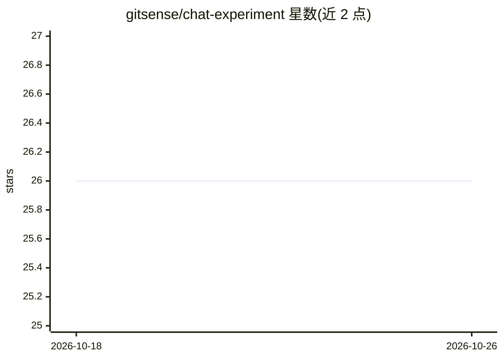

# gitsense/chat-experiment

⭐ 26 · JavaScript · 推送 2026-02-21 · [GitHub](https://github.com/gitsense/chat-experiment) · 组织维护

**面向软件开发的 LLM 对话平台：上下文工程+可溯源代码生成**

GitSense Chat 是一个自托管的 LLM 对话平台，面向开发者构建与软件相关的 AI 工作流：提供精确的上下文构建与管理工具、可溯源的代码生成、可对话的知识库（wiki）、基于自有知识库的 AI 搜索助手，以及 Messages Tool 将对话内容导出到 IDE 或其他工具。预置 Claude、Gemini、GPT-5、GPT OSS 120B 四个模型，通过 API key 接入 Anthropic/OpenAI/Google/OpenRouter 等提供商。支持 npm 源码运行与 Docker 部署，另以商业版 GitSense Chat Bridge 变现。注意：本仓库已更名为 chat-experiment 且停止维护，正式版本迁移至 gitsense/chat。

## 筛选速览

| 维度 | 判定 | 备注 |
|---|---|---|
| AI 角色 | `ai-native` | 本体是模型或模型工具 |
| 许可风险 | `none` | — |
| 部署形态 | `self-host` | docker 或自建部署 |
| 模型依赖 | locked-api |  |
| 硬件要求 | — | 无带数字的原话,不猜 |
| 安装摩擦 | `low` | 无编译、无系统依赖或容器化 |
| 成熟度 | — | 结构信号不足 |

## 能力要点

- 上下文工程工具：构建、精炼并管理 LLM 的知识库以提升响应相关性
- 可对话的知识库与基于自有数据的 AI 搜索助手
- 预置 4 个模型（Anthropic/Google/OpenAI/OpenRouter），仅需配置所用提供商的 API key
- 提供 npm 与 Docker 两种安装运行方式，gsc-admin CLI 管理模型与配置

## 适用场景

- 在自托管环境中进行带精确上下文管理的 LLM 对话与代码生成
- 把仓库、文档等文本数据导入知识库后用自然语言搜索（如查找高优先级 TODO）
- 团队搭建可对话的内部 wiki 与技术资料库

## 场景标签

`代码生成` `知识库管理` `语义搜索` · 领域:编码与开发

## 证据(README 行号)

> L7: GitSense Chat is reimagining how we can interact with Large Language Models (LLMs) to build better software, togethe
> L28: Simply chat with an LLM to make your data smarter. With GitSense Chat, you can turn any text-based data into intell

## 星数曲线

2026-10-18 26 → 2026-10-26 26（+0）

---
*卡片 v1 · prompt 1.4 · 生成 2026-10-26 · 置信度 high · 依据 README sha `4e5a2947b756` · [字段定义](../../DATASET.md)*
