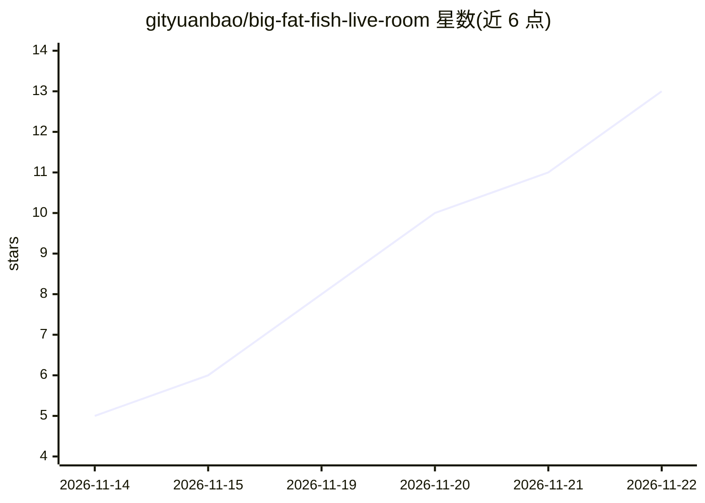

# gityuanbao/big-fat-fish-live-room

⭐ 13 · Python · MIT · 推送 2026-11-13 · [GitHub](https://github.com/gityuanbao/big-fat-fish-live-room) · 个人维护 · 中文 README

**Windows 本地虚拟直播工作室，驱动虚拟主播回应弹幕直播**

git源宝工作室出品的 Windows 本地虚拟直播程序：观众弹幕经用户自配的模型 API 生成口语回复，经语音 API 合成播报，并联动角色动作视频；支持 B站/抖音弹幕接入、弹幕点歌（网易云）、OBS 浏览器源与 WebSocket 场景联动、本地虚拟直播间排练。当前 v0.7.2 仅提供源码发布（约 200 MB，含动作视频），需 Python 3.12 与 Windows x64，免安装运行包将单独发布于 Releases。模型、语音密钥与平台账号由用户自备。

## 筛选速览

| 维度 | 判定 | 备注 |
|---|---|---|
| AI 角色 | `ai-enhanced` | 去掉 AI 部分产品仍成立 |
| 许可风险 | `permissive` | MIT |
| 部署形态 | `desktop` | 安装包/桌面程序 |
| 模型依赖 | — | README 未给出锁定关系 |
| 硬件要求 | — | 无带数字的原话,不猜 |
| 安装摩擦 | `low` | 无编译、无系统依赖或容器化 |
| 成熟度 | — | 结构信号不足 |

## 能力要点

- 弹幕触发模型回复、语音合成与动作视频联动
- 支持 B站/抖音弹幕接入与弹幕点歌
- OBS 浏览器源与 WebSocket 场景同步
- 本地虚拟直播间可在不连接平台的情况下排练

## 适用场景

- 在 B站或抖音运营一个 AI 虚拟主播直播间
- 先在本地虚拟直播间测试回复与动作再开播
- 给虚拟角色配置触发词动作与才艺表演

## 场景标签

`语音合成` · 领域:内容生成

## 证据(README 行号)

> L6: Windows 本地虚拟直播工作室 · v0.7.2 · git源宝工作室出品
> L12: 观众发弹幕，大肥鱼用你配置的模型与音色回应，联动动作视频。先在虚拟直播间排练，再连接 B站 / 抖音与 OBS。
> L17: - 语音 API、阿里百炼音色 ID、固定词句试听；可选本地 Piper 备用。

## 星数曲线

2026-11-14 5 → 2026-11-22 13（+8）

---
*卡片 v1 · prompt 1.4 · 生成 2026-11-20 · 置信度 mid · 依据 README sha `5f54c4b77208` · [字段定义](../../DATASET.md)*
