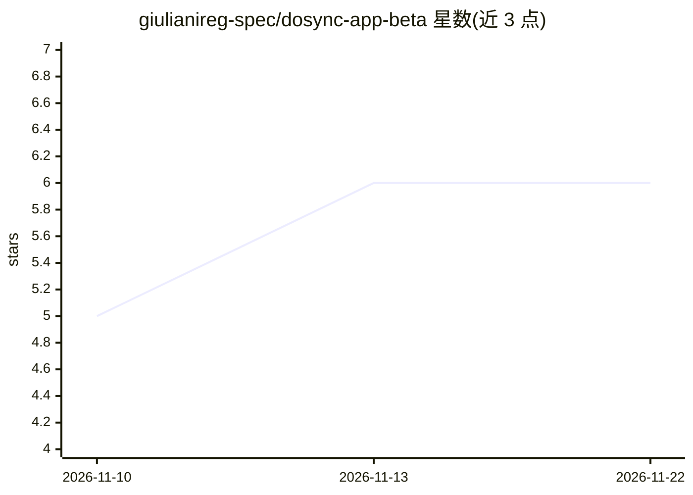

# giulianireg-spec/dosync-app-beta

⭐ 6 · Shell · NOASSERTION · 推送 2026-11-21 · [GitHub](https://github.com/giulianireg-spec/dosync-app-beta) · [官网](https://dosync.dev/app/) · 个人维护

**以手机为中控、用自然语言操控智能家居的 Android 应用**

DoSync 是免费的 Android 应用（8.0+），将手机作为智能家居中枢：扫描 Wi-Fi/蓝牙发现设备，支持约 79 个品牌与 Home Assistant、Zigbee2MQTT 等平台，提供场景、例程、红外控制与多家庭/家庭共享功能。指令理解内置支持 6 种语言、无需 AI；AI 为可选功能，可用用户自己的 Claude/Gemini/ChatGPT、端侧 Gemini Nano，或经 Wi-Fi 发现本机 Ollama/LM Studio（推荐 qwen3）实现命令不出户的本地推理。源代码未公开，仅在此仓库发布 APK、版本说明并收集反馈；可选在树莓派/旧电脑安装同引擎的 DoSync hub 实现外出后继续响应。敏感操作需用户确认。

## 筛选速览

| 维度 | 判定 | 备注 |
|---|---|---|
| AI 角色 | `ai-enhanced` | 去掉 AI 部分产品仍成立 |
| 许可风险 | `none` | NOASSERTION |
| 部署形态 | `None` |  |
| 模型依赖 | local-ok | 支持本地模型 |
| 硬件要求 | — | 无带数字的原话,不猜 |
| 安装摩擦 | `low` | 无编译、无系统依赖或容器化 |
| 成熟度 | `idea` | |

## 能力要点

- 手机即中枢，Wi-Fi/蓝牙自动发现设备，支持约 79 个品牌
- 6 语言指令理解在手机本地完成、无需 AI；AI 为可选层
- 可选接入自备 Claude/Gemini/ChatGPT、端侧 Gemini Nano 或局域网内 Ollama/LM Studio
- 支持 Home Assistant、Zigbee2MQTT、SmartThings 等平台设备及例程、红外、多家庭

## 适用场景

- 不想购买额外网关、用手机直接管理全屋智能设备
- 局域网内用 Ollama 让指令数据不出家门
- 以一句话控制多设备并创建定时/条件触发的例程
- 家人通过一次性加密码共享同一套家庭控制

## 场景标签

 · 领域:智能家居/物联网

## 证据(README 行号)

> L10: DoSync is a free Android app that runs your home in your own words: *"turn off all
> L40:  German and Italian) on the phone, free, without AI.
> L41: - **With AI (optional)**, your own (Claude, Gemini or ChatGPT) or on-device Gemini
> L43: - **Or free AI on your own computer**, with Ollama or LM Studio:

## 星数曲线

2026-11-10 5 → 2026-11-22 6（+1）

---
*卡片 v1 · prompt 1.4 · 生成 2026-11-20 · 置信度 high · 依据 README sha `f8d65ed3d260` · [字段定义](../../DATASET.md)*
