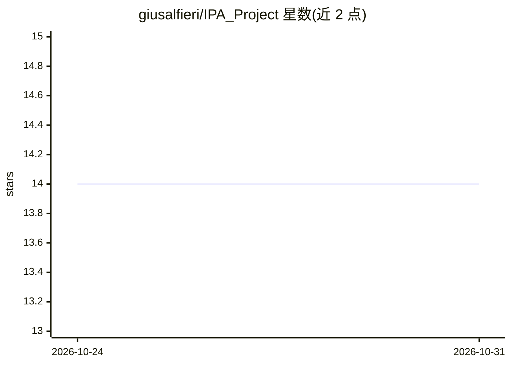

# giusalfieri/IPA_Project

⭐ 14 · C++ · MIT · 推送 2026-10-22 · [GitHub](https://github.com/giusalfieri/IPA_Project) · 组织维护

**用 CV 与 SVM 检测卫星图像中飞机的流水线工具**

C++20/Python 编写的卫星图像飞机检测项目：按固定顺序执行飞机提取、按尺寸/亮度的 K-Means 聚类、图像缩放、eigenplanes 生成、基于模板匹配的 SVM 训练数据提取与性能评估。SVM 部分依赖 ucasML CLI 工具（需另行安装），训练数据为 HRPlanesv2 子集，中间结果通过 .done 文件跟踪步骤完成状态。源码经 CMake 编译运行，部分预处理产物需从 Google Drive 下载。

## 筛选速览

| 维度 | 判定 | 备注 |
|---|---|---|
| AI 角色 | `ai-native` | 本体是模型或模型工具 |
| 许可风险 | `permissive` | MIT |
| 部署形态 | `None` |  |
| 模型依赖 | — | README 未给出锁定关系 |
| 硬件要求 | — | 无带数字的原话,不猜 |
| 安装摩擦 | `medium` | 含编译或系统依赖之一 |
| 成熟度 | — | 结构信号不足 |

## 能力要点

- 7 步固定顺序的检测流水线，含 K-Means 聚类与 eigenplanes 生成
- SVM 训练数据提取采用模板匹配
- .done 文件机制校验步骤执行前提
- 支持命令行与 CMake GUI/Visual Studio 两种构建方式

## 适用场景

- 在卫星图像数据集上跑完整的飞机检测流水线
- 复现基于 SVM 的飞机分类实验
- 逐步执行各计算阶段以控制资源开销

## 场景标签

`目标检测` · 领域:感知与多模态

## 证据(README 行号)

> L7: This project focuses on detecting aircraft in satellite images using various Computer Vision and Machine Learning te
> L35: The aim of this project is to develop an automated system for detecting aircraft in satellite imagery. The project 

## 星数曲线

2026-10-24 14 → 2026-10-31 14（+0）

---
*卡片 v1 · prompt 1.4 · 生成 2026-10-31 · 置信度 high · 依据 README sha `889b4978cb84` · [字段定义](../../DATASET.md)*
