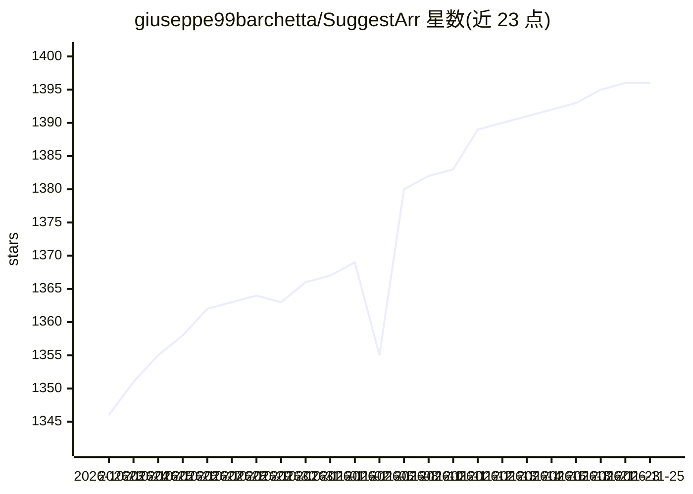

# giuseppe99barchetta/SuggestArr

⭐ 1,396 · Python · MIT · 推送 2026-11-23 · [GitHub](https://github.com/giuseppe99barchetta/SuggestArr) · [官网](https://giuseppe99barchetta.github.io/SuggestArr/) · 个人维护

**根据观看历史自动向 Seer 提交影视推荐请求的工具**

读取 Jellyfin/Plex/Emby 的观看记录，通过 TMDb 或 OpenAI 兼容 LLM 生成相似内容推荐，并自动向 Jellyseerr/Overseerr 或直接向 Radarr/Sonarr 提交下载请求。提供 Web 界面管理配置、定时任务与实时日志，支持请求审批、待处理暂停、清理旧请求等控制机制，可选接入 Trakt/Simkl 历史与 MDBList 公开列表导入。需 Docker 或 Python 3 运行，须配置 TMDb API key 与媒体服务器。

## 筛选速览

| 维度 | 判定 | 备注 |
|---|---|---|
| AI 角色 | `ai-enhanced` | 去掉 AI 部分产品仍成立 |
| 许可风险 | `permissive` | MIT |
| 部署形态 | `self-host` | docker 或自建部署 |
| 模型依赖 | — | README 未给出锁定关系 |
| 硬件要求 | — | 无带数字的原话,不猜 |
| 安装摩擦 | `low` | 无编译、无系统依赖或容器化 |
| 成熟度 | — | 结构信号不足 |

## 能力要点

- 从 Jellyfin/Plex/Emby 观看历史生成推荐并自动提交下载请求
- 推荐来源支持 TMDb 或任意 OpenAI 兼容 LLM，附每条推荐理由
- AI Search 支持自然语言描述想看的内容并一键请求
- 提供公开 REST API 与 Swagger UI，支持 SQLite/PostgreSQL/MySQL

## 适用场景

- 自动根据我看过的剧集向 Overseerr 提交相似内容请求
- 定期从 Trakt 或 MDBList 导入片单并定时请求
- 自动清理没人收藏的旧请求及其媒体文件

## 场景标签

`工作流自动化` · 领域:效率与自动化

## 证据(README 行号)

> L10: SuggestArr automates media recommendations and download requests based on what you watch on **Jellyfin**, **Plex** 
> L15: - **Recommendations** from TMDb, or from any OpenAI-compatible LLM (OpenAI, Ollama, OpenRouter, LiteLLM…) with a sh

## 星数曲线

2026-10-23 1,346 → 2026-11-25 1,396（+50）

---
*卡片 v1 · prompt 1.4 · 生成 2026-11-23 · 置信度 high · 依据 README sha `1e5ce0491a17` · [字段定义](../../DATASET.md)*
