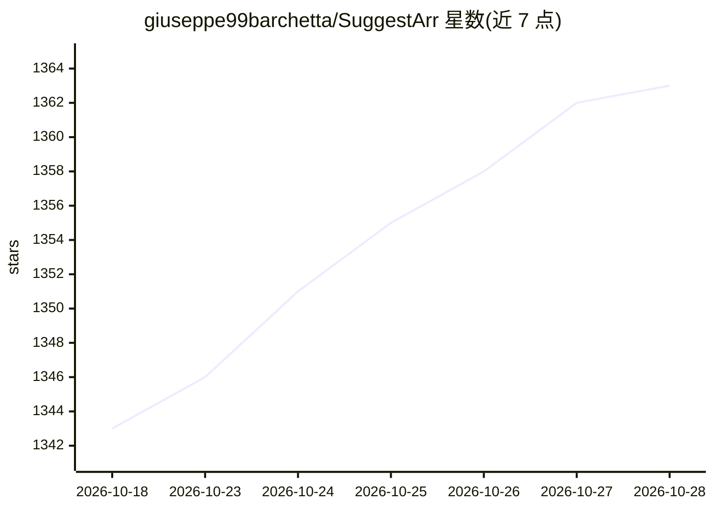

# giuseppe99barchetta/SuggestArr

⭐ 1,364 · Python · MIT · 推送 2026-10-28 · [GitHub](https://github.com/giuseppe99barchetta/SuggestArr) · [官网](https://giuseppe99barchetta.github.io/SuggestArr/) · 个人维护

**基于观影历史自动推荐并向 Seer 提交下载请求的媒体自动化工具**

面向 Jellyfin/Plex/Emby 家庭媒体服务器用户：读取最近观看内容，通过 TMDb API 检索相似影片，并向 Jellyseerr/Overseerr（Seer）自动提交下载请求。提供 Web 界面、cron 调度、请求审批与暂停策略、清理自动化、Trakt 观影历史集成。AI 为可选 beta 功能：任意 OpenAI 兼容 API（含本地 Ollama）生成个性化推荐与自然语言搜片，LLM 不可用时回退到 TMDb 算法。需 Python 3.x 或 Docker、TMDb API Key 与已配置的 Seer。

## 筛选速览

| 维度 | 判定 | 备注 |
|---|---|---|
| AI 角色 | `ai-enhanced` | 去掉 AI 部分产品仍成立 |
| 许可风险 | `permissive` | MIT |
| 部署形态 | `self-host` | docker 或自建部署 |
| 模型依赖 | local-ok | 支持本地模型 |
| 硬件要求 | — | 无带数字的原话,不猜 |
| 安装摩擦 | `low` | 无编译、无系统依赖或容器化 |
| 成熟度 | `idea` | |

## 能力要点

- 读取 Jellyfin/Plex/Emby 观看历史，经 TMDb 检索相似内容并自动向 Seer 提交请求
- AI 推荐 beta：任意 OpenAI 兼容 LLM（OpenAI/Ollama/OpenRouter/LiteLLM），LLM 失败回退 TMDb 算法
- AI 搜索 beta：自然语言描述观片需求，LLM 转为 TMDb 结构化过滤
- 请求审批、待审暂停、清理自动化等安全机制；支持外部 PostgreSQL/MySQL

## 适用场景

- 让媒体库根据观看历史自动补充新内容
- 用自然语言描述想看什么让 AI 找片并一键请求
- 多人共用环境下按用户管理自动请求与审批

## 场景标签

`推荐系统` · 领域:学习与行业

## 证据(README 行号)

> L10: SuggestArr is a project designed to automate media content recommendations and download requests based on user acti
> L25: - **AI-Powered Recommendations** *(beta)*: Uses any OpenAI-compatible LLM (OpenAI, Ollama, Gemini, LiteLLM…) to gen
> L157: > If the LLM is unavailable or returns no results, SuggestArr falls back to the standard TMDb-based recommendation

## 星数曲线

2026-10-18 1,343 → 2026-10-28 1,363（+20）

---
*卡片 v1 · prompt 1.4 · 生成 2026-10-21 · 置信度 high · 依据 README sha `1a7d9bf52d23` · [字段定义](../../DATASET.md)*
