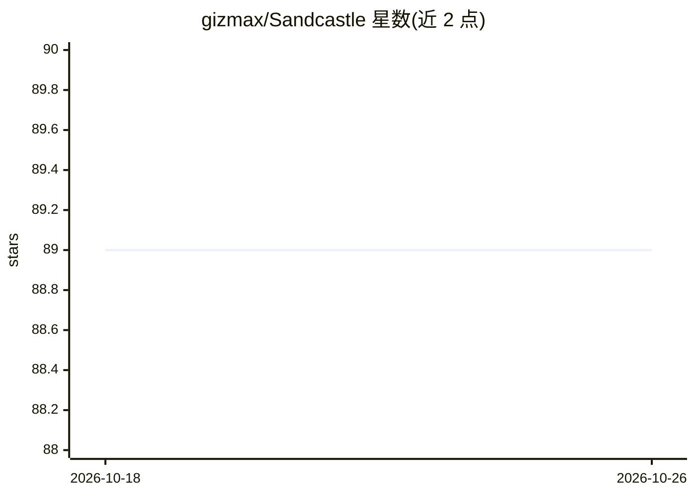

# gizmax/Sandcastle

⭐ 89 · Python · NOASSERTION · 推送 2026-08-26 · [GitHub](https://github.com/gizmax/Sandcastle) · [官网](https://sandcastle-ai.eu) · 组织维护

**面向主权与合规场景的开源 AI agent 工作流编排器**

用 YAML 或自然语言描述（Omnibox）生成 AI agent 工作流，在任意模型（Claude/GPT/Mistral/本地模型）上运行并支持一行切换。提供 DAG 编排、26 种步骤类型、7 个云 provider 自动故障转移、SHA-256 哈希链防篡改审计、data_residency 本地/EU 强制、成本计量与仪表盘。本地优先：Ollama/NIM/oMLX 为一级 provider，本地推理按 $0/run 计费，可完全离线气隙部署。Spark Mode 自动检测 NVIDIA DGX Spark；Mesh 可将多台机器组成按能力调度（gpu/browser）的执行网络。Python 3.12+，pip 安装，本地模式零外部依赖（SQLite/进程内队列），可按步升级到 PostgreSQL/Redis/S3 或 Docker Compose。许可为 BSL 1.1。

## 筛选速览

| 维度 | 判定 | 备注 |
|---|---|---|
| AI 角色 | `ai-ecosystem` | LLM/agent 周边工具 |
| 许可风险 | `none` | NOASSERTION |
| 部署形态 | `self-host` | docker 或自建部署 |
| 模型依赖 | local-ok | 支持本地模型 |
| 硬件要求 | — | 无带数字的原话,不猜 |
| 安装摩擦 | `low` | 无编译、无系统依赖或容器化 |
| 成熟度 | — | 结构信号不足 |

## 能力要点

- 自然语言（Omnibox）生成工作流，或手写 YAML；模型间一行切换
- SHA-256 哈希链审计轨迹、black_box 合规模式、sandcastle audit verify 可重放校验
- data_residency=local/eu 在执行器层面强制，运行前阻止数据离机
- Spark Mode 自动检测 NVIDIA DGX Spark 并启用本地优先默认；Mesh 按能力（gpu/browser/code）跨机器调度步骤
- 本地模式无 Docker/数据库/Redis 依赖，SQLite 自动创建，可渐进升级至 PostgreSQL/Redis/S3

## 适用场景

- 受监管环境（公共部门、医疗、金融）中运行不离机数据的 agent 工作流
- 在自有硬件（DGX Spark/本地 Ollama）上以 $0 运行成本执行 agent 流水线
- 为 EU AI Act 合规留存可重放、防篡改的运行审计记录
- 多机器按能力（GPU/浏览器/代码）协同执行同一工作流

## 场景标签

`工作流自动化` · 领域:效率与自动化

## 证据(README 行号)

> L3: **Build once. Run anywhere.** Sandcastle is an open-source, production-ready orchestrator for AI agents. **Describe 
> L45: - **Local-first execution.** NVIDIA NIM, Ollama, and oMLX are first-class providers at `region=local`. Spark Mode a
> L67: Sandcastle handles all of that. Define workflows in YAML, pick your sandbox backend, choose your models, and ship t

## 星数曲线

2026-10-18 89 → 2026-10-26 89（+0）

---
*卡片 v1 · prompt 1.4 · 生成 2026-10-23 · 置信度 high · 依据 README sha `41fa2a70bfab` · [字段定义](../../DATASET.md)*
