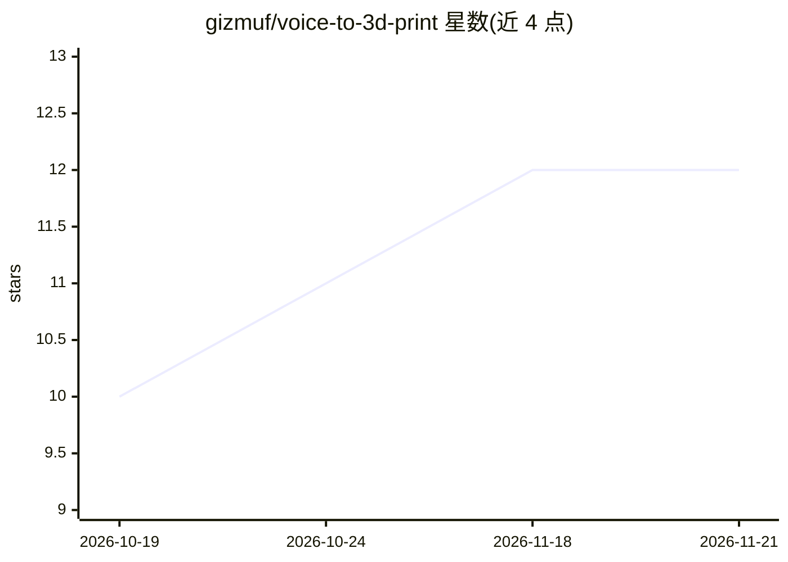

# gizmuf/voice-to-3d-print

⭐ 12 · Python · AGPL-3.0 · 推送 2026-11-16 · [GitHub](https://github.com/gizmuf/voice-to-3d-print) · [官网](https://3d.pulsai.app) · 个人维护

**AI 参数化 CAD 工具：对话与语音生成可编辑模型并准备 3D 打印文件**

开源 AI-first 参数化 CAD 工具，可从文字描述、模板或已有 CAD 文件起步，通过参数、命名特征或对话编辑生成 build123d/OpenCascade 参数化模型，导出 STEP、STL、GLB、DXF 及可选 FDM G-code。确定性本地编辑路径无需付费 AI 调用；复杂自然语言编辑可接入 provider-backed agent，生成的 CAD 代码经审计与隔离，失败构建不替换上一有效模型。项目状态为公开 alpha，未经安全认证，制造前需自行复核模型与 G-code。AGPL-3.0 许可，支持自托管。

## 筛选速览

| 维度 | 判定 | 备注 |
|---|---|---|
| AI 角色 | `ai-native` | 本体是模型或模型工具 |
| 许可风险 | `dual` | AGPL-3.0 |
| 部署形态 | `None` |  |
| 模型依赖 | — | README 未给出锁定关系 |
| 硬件要求 | — | 无带数字的原话,不猜 |
| 安装摩擦 | `low` | 无编译、无系统依赖或容器化 |
| 成熟度 | `idea` | |

## 能力要点

- build123d/OpenCascade 参数化模型为源头，导出 STEP/STL/GLB/DXF/可选 G-code
- 确定性本地参数编辑无需付费 AI，AI 保留给歧义或结构性修改
- 生成 CAD 代码经审计与隔离，保留修订哈希与制造性检查
- 可选集成 Anthropic、OpenAI、Gemini、Meshy、Tripo、Trellis2、TripoSR

## 适用场景

- 用对话或语音把想法快速变成可打印的 3D 模型
- 基于模板或已有 STEP/STL 文件做参数化修改
- 从 CAD 到 FDM 打印准备打包在一套工作流里完成
- 给编码 agent 提供可检查的结构化 CAD 工具面

## 场景标签

 · 领域:CAD/制造

## 证据(README 行号)

> L3: **Open-source, AI-first parametric CAD for turning an idea into an editable
> L26: manufacturability signals; and export STEP, STL, GLB, DXF, or optional FDM
> L61: |Providers|Deterministic local path plus optional Anthropic, OpenAI, Gemini, Meshy, Tripo, Trellis2, and TripoSR in

## 星数曲线

2026-10-19 10 → 2026-11-21 12（+2）

---
*卡片 v1 · prompt 1.4 · 生成 2026-11-18 · 置信度 high · 依据 README sha `ad9d992772c6` · [字段定义](../../DATASET.md)*
