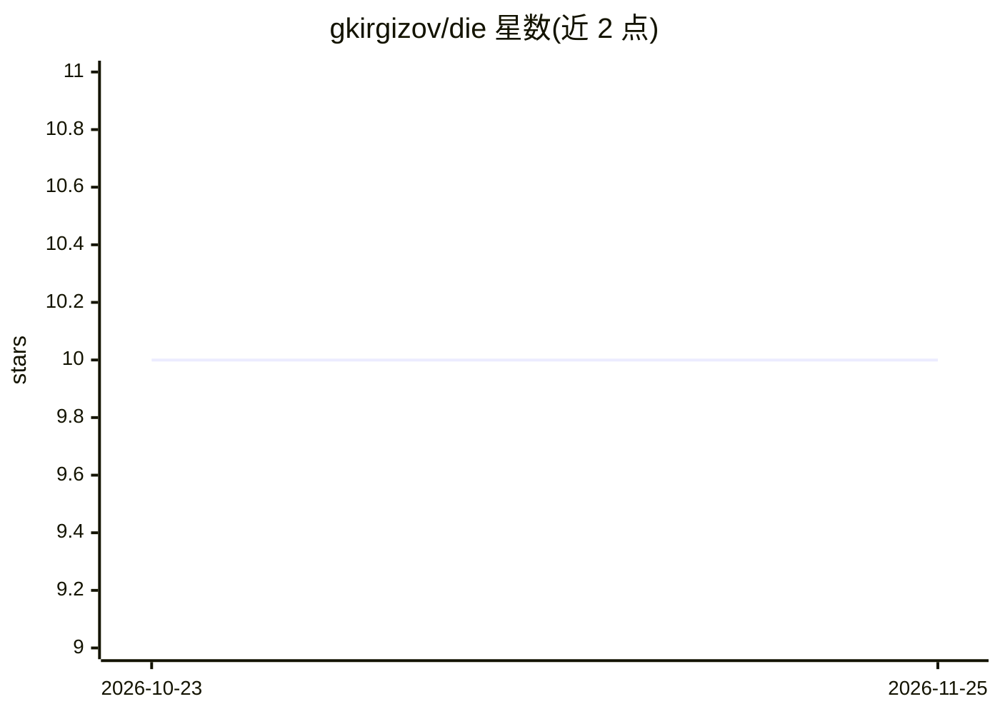

# gkirgizov/die

⭐ 10 · Python · BSD-3-Clause · 推送 2026-10-20 · [GitHub](https://github.com/gkirgizov/die) · 个人维护

**人工生命科研工具：用学习型元胞自动机模拟分布式智能涌现**

一个 Gym 环境形式的人工生命项目：环境提供觅食、进食、存活等压力，多个体共享策略的学习型元胞自动机作为 agent，观察与动作空间连续、计算向量化。训练通过演化策略（evosax/evotorch 后端）演化 Neural Cellular Automata，另提供 PPO 强化学习路径与 rejax 交叉验证；运行用 MLflow 跟踪、支持种子复现与 checkpoint 回放。需要 Python ≥ 3.12 与 uv；GPU 加速训练仅在 NVIDIA/Linux 上可选。

## 筛选速览

| 维度 | 判定 | 备注 |
|---|---|---|
| AI 角色 | `ai-native` | 本体是模型或模型工具 |
| 许可风险 | `permissive` | BSD-3-Clause |
| 部署形态 | `None` |  |
| 模型依赖 | — | README 未给出锁定关系 |
| 硬件要求 | — | 无带数字的原话,不猜 |
| 安装摩擦 | `medium` | 含编译或系统依赖之一 |
| 成熟度 | — | 结构信号不足 |

## 能力要点

- Gym 环境 + 学习型元胞自动机 agent（Physarum/Brownian 等实现）
- 演化策略训练 Neural CA，JAX 向量化核心，evosax 与 evotorch 双后端
- 同一核心上的 PPO 强化学习路径及独立 rejax 交叉验证实现
- MLflow 全程跟踪、种子化可复现实验与 checkpoint 回放

## 适用场景

- 研究环境压力下协作行为的涌现过程
- 实验演化策略与 PPO 在元胞自动机 agent 上的训练
- 复现 Physarum 等群体行为模式生成 GIF 演示

## 场景标签

`科研工具` `强化学习` · 领域:学习与行业

## 证据(README 行号)

> L3: **DIE** is an Artificial Life project aimed at reproducing emergence of distributed intelligence under environmental
> L7: It implements nature-like **Gym environment** with essential pressures for foraging, feeding, *not-dying*, together 
> L104: - **Learning agents**: evolutionary Neural Cellular Automata, evolved on a vectorized JAX core.

## 星数曲线

2026-10-23 10 → 2026-11-25 10（+0）

---
*卡片 v1 · prompt 1.4 · 生成 2026-11-19 · 置信度 high · 依据 README sha `4360ee12be11` · [字段定义](../../DATASET.md)*
