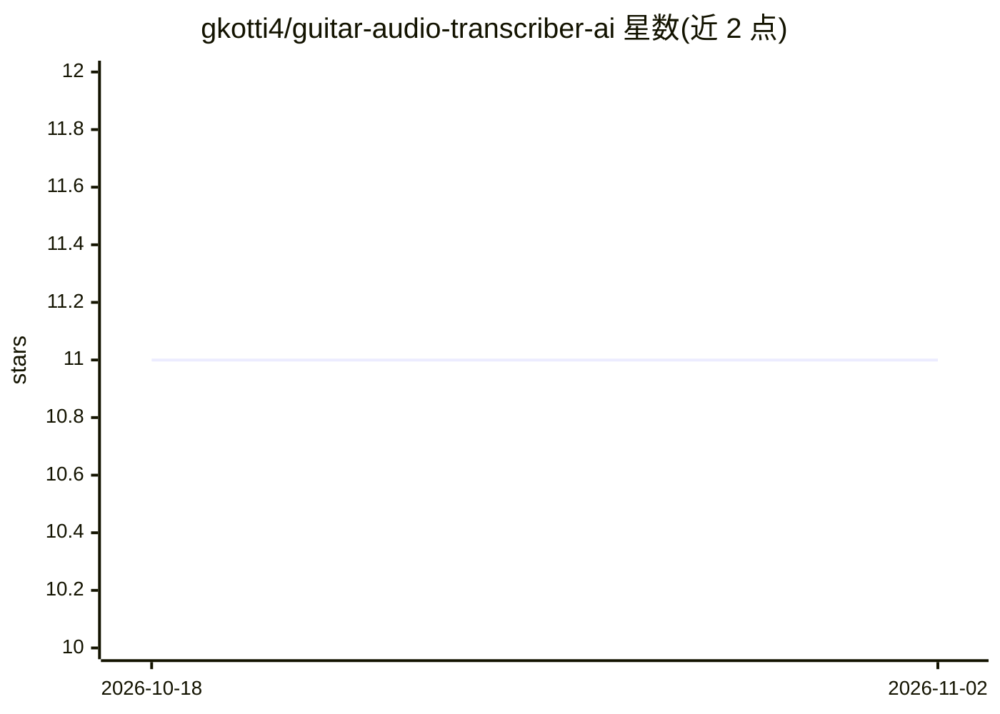

# gkotti4/guitar-audio-transcriber-ai

⭐ 11 · Python · 推送 2026-02-19 · [GitHub](https://github.com/gkotti4/guitar-audio-transcriber-ai) · 个人维护

**单音吉他音频转音符预测的深度学习研究管线**

研究驱动的单音吉他音高转录系统：将原始吉他音频经切分（onset 检测）、MFCC/Mel 频谱特征提取后送入 PyTorch CNN 与 MLP 模型推理，输出科学音高记号（如 E2、F#3）的音符预测，支持单条与批量推理及集成式推理，含 YIN 基线。仓库不含完整训练数据集、可复现训练配置与打包应用，Version 1 处于持续重构与实验阶段，多音轨、MIDI 导出、实时流式转录为规划中方向。

## 筛选速览

| 维度 | 判定 | 备注 |
|---|---|---|
| AI 角色 | `ai-native` | 本体是模型或模型工具 |
| 许可风险 | `none` | — |
| 部署形态 | `None` |  |
| 模型依赖 | — | README 未给出锁定关系 |
| 硬件要求 | — | 无带数字的原话,不猜 |
| 安装摩擦 | `low` | 无编译、无系统依赖或容器化 |
| 成熟度 | `idea` | |

## 能力要点

- Onset 自动切分 + MFCC/Mel 频谱特征管线
- PyTorch CNN 主模型与 MLP 基线/集成推理
- 科学音高记号输出（E2、F#3 等）
- 提供内存音频的结构化推理 API 与 YIN 基线

## 适用场景

- 对单音吉他录音片段做端到端音符预测
- 研究学习型音高表示与经典 DSP 的差异
- 在自有数据上实验领域自适应与分割鲁棒性改进

## 场景标签

`科研工具` · 领域:学习与行业

## 证据(README 行号)

> L3: An in-development audio application and research-driven project focused on monophonic guitar pitch transcription.
> L5: This system converts raw guitar audio into structured note predictions (e.g., `E2`, `F#3`) using a hybrid signal pro
> L72: |Models|PyTorch CNN (primary) + MLP (baseline / ensemble)|

## 星数曲线

2026-10-18 11 → 2026-11-02 11（+0）

---
*卡片 v1 · prompt 1.4 · 生成 2026-11-02 · 置信度 high · 依据 README sha `5078ede69265` · [字段定义](../../DATASET.md)*
