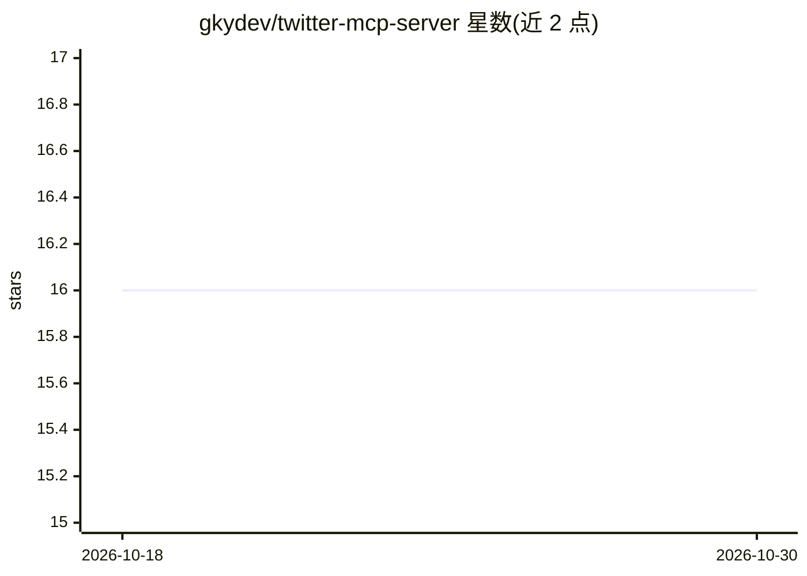

# gkydev/twitter-mcp-server

⭐ 16 · Python · 推送 2026-05-31 · [GitHub](https://github.com/gkydev/twitter-mcp-server) · 个人维护

**让 AI 助手操作 Twitter 的非官方 MCP 服务器（cookie 认证）**

基于 twikit 库实现的 MCP 服务器，使 AI 助手通过标准化协议与 Twitter 交互。认证方式为 LLM 在工具调用中直接提供 ct0 与 auth_token 两个 cookie，会话自动缓存，无需预配置。功能覆盖发推、点赞、转推、书签、搜索推文与用户、获取时间线与用户信息、关注/取关、私信收发与反应、获取趋势话题等。项目声明使用非官方 API，仅供教育实验用途，存在账号受限风险。安装方式为 git clone 后 pip 安装依赖并运行 server.py。

## 筛选速览

| 维度 | 判定 | 备注 |
|---|---|---|
| AI 角色 | `ai-ecosystem` | LLM/agent 周边工具 |
| 许可风险 | `none` | — |
| 部署形态 | `library` | 以包/库形式分发 |
| 模型依赖 | — | README 未给出锁定关系 |
| 硬件要求 | — | 无带数字的原话,不猜 |
| 安装摩擦 | `low` | 无编译、无系统依赖或容器化 |
| 成熟度 | — | 结构信号不足 |

## 能力要点

- LLM 在工具调用中直接传入 ct0/auth_token cookie，无需预配置
- 发推/点赞/转推/搜索/时间线/用户操作/趋势话题等工具集
- 私信收发、emoji 反应、删除消息与私信历史获取
- 基于 twikit 非官方 API，自带会话缓存

## 适用场景

- 让 Claude 等 MCP 客户端代为发推、点赞、转推
- 通过对话获取 Twitter 时间线、趋势话题与用户信息
- 用 AI 助手收发与管理 Twitter 私信

## 场景标签

 · 领域:agent 工具/社交媒体

## 证据(README 行号)

> L3: A Model Context Protocol (MCP) server that provides Twitter functionality using the `twikit` library. This server al
> L47: The server expects the LLM model to provide Twitter cookies directly in each tool call via the `ct0` and `auth_toke

## 星数曲线

2026-10-18 16 → 2026-10-30 16（+0）

---
*卡片 v1 · prompt 1.4 · 生成 2026-10-30 · 置信度 mid · 依据 README sha `30d51aabcd3d` · [字段定义](../../DATASET.md)*
