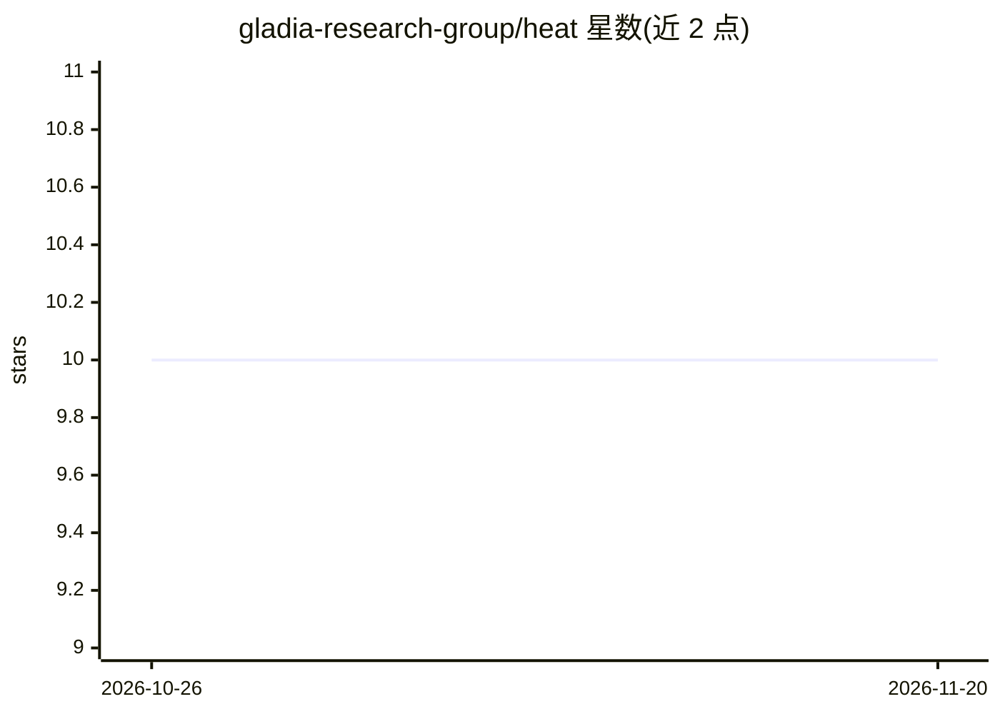

# gladia-research-group/heat

⭐ 10 · Python · NOASSERTION · 推送 2026-10-01 · [GitHub](https://github.com/gladia-research-group/heat) · [官网](https://arxiv.org/pdf/2609.01730) · 组织维护

**研究代码库：对加密 GPT-2/ViT/BERT 做同态加密感知微调训练**

HEAT 是论文《Faster Fully Homomorphic Inference via Approximations-Weights Co-Adaptation》的配套代码，提供复现降深度训练实验与加密推理 bootstrap 计划的完整流水线：数据准备、近似域校准、Hydra 驱动的可学习迭代数训练、明文评估、权重导出，以及在 Perseus FHE 后端（作为 git 子模块内嵌）上运行加密 GPT-2 解码。面向复现论文结果的研究者，训练与校准无需构建后端，加密运行需 GPU 节点并从源码构建 OpenFHE/FIDESlib 依赖链。MIT 许可。

## 筛选速览

| 维度 | 判定 | 备注 |
|---|---|---|
| AI 角色 | `ai-native` | 本体是模型或模型工具 |
| 许可风险 | `none` | NOASSERTION |
| 部署形态 | `None` |  |
| 模型依赖 | — | README 未给出锁定关系 |
| 硬件要求 | — | 无带数字的原话,不猜 |
| 安装摩擦 | `high` | 编译与系统依赖俱全 |
| 成熟度 | — | 结构信号不足 |

## 能力要点

- 可学习非线性迭代数与权重协同适应的微调方法
- 每阶段均为 Hydra 入口点，由配置覆盖驱动
- 内嵌 Perseus FHE 后端（src/perseus 子模块），附预计算 bootstrap 计划
- 论文附录的 Lean 4 形式化证明（proofs/）

## 适用场景

- 复现论文中加密 GPT-2 解码实验结果
- 对 ViT 模型进行同态加密感知训练
- 研究 FHE 推理中近似迭代数与电路深度的权衡

## 场景标签

`微调` · 领域:训练与推理

## 证据(README 行号)

> L16: Fully homomorphic encryption (FHE) allows a server to run a language model directly on encrypted user prompts, but 
> L20: This repository contains the code necessary to replicate the depth reducing training experiment and the bootstrap p
> L88: python src/he_aware_training/scripts/prepare_data.py model=gpt2 dataset=openwebtext

## 星数曲线

2026-10-26 10 → 2026-11-20 10（+0）

---
*卡片 v1 · prompt 1.4 · 生成 2026-11-19 · 置信度 high · 依据 README sha `ca742af79c62` · [字段定义](../../DATASET.md)*
