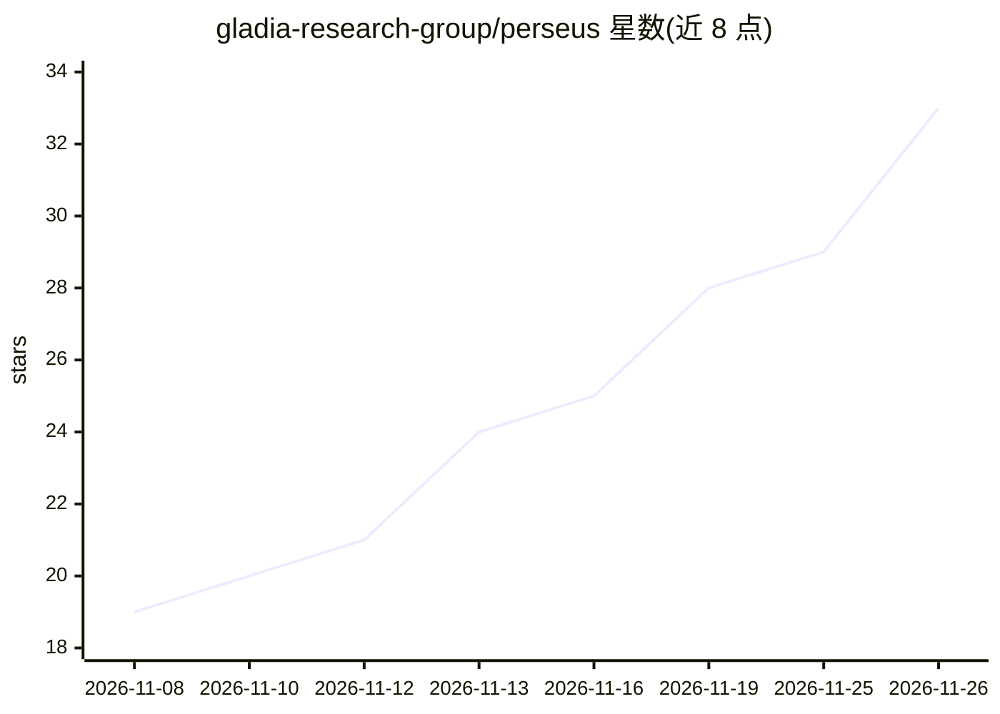

# gladia-research-group/perseus

⭐ 33 · Rust · NOASSERTION · 推送 2026-11-24 · [GitHub](https://github.com/gladia-research-group/perseus) · [官网](https://arxiv.org/pdf/2611.04488) · 组织维护

**GPU 上全同态加密的 transformer 推理框架**

基于 CKKS 的全同态加密模型推理全栈系统：服务器在密文上运行 transformer，明文侧不可见数据。模型（GPT-2、Llama-3、BERT、ViT、SANA-Sprint 等）以 Python 编写并被逐块录制、编译为程序，由 Rust + CUDA 运行时重放；提供自举放置规划器、复数槽打包、GPU 内密钥再生与客户端/服务端分离。在单张 RTX PRO 6000 上给出加密 Llama-3-8B、GPT-2 等模型的端到端计时；Llama 等测量需 96 GB GPU。

## 筛选速览

| 维度 | 判定 | 备注 |
|---|---|---|
| AI 角色 | `ai-ecosystem` | LLM/agent 周边工具 |
| 许可风险 | `none` | NOASSERTION |
| 部署形态 | `library` | 以包/库形式分发 |
| 模型依赖 | — | README 未给出锁定关系 |
| 硬件要求 | — | 无带数字的原话,不猜 |
| 安装摩擦 | `medium` | 含编译或系统依赖之一 |
| 成熟度 | — | 结构信号不足 |

## 能力要点

- 支持加密语言建模、图像/句子分类与文生图（SANA-Sprint 0.6B，269 s 出 768×768 图）
- Python 编写模型，逐块编译后由 Rust + CUDA CKKS 运行时重放，关键路径无 Python
- 自举放置规划器感知打包与幅度（GPT-2 每 token 416 次自举）
- 客户端持有私钥、服务器仅持密钥包的 client/server 分离结构

## 适用场景

- 在不向服务器暴露明文的前提下部署 transformer 推理
- 研究 CKKS 自举放置与打包策略对加密推理性能的影响
- 复现论文中加密 Llama-3/GPT-2/BERT/ViT 的计时与精度结果

## 场景标签

`推理引擎` · 领域:训练与推理

## 证据(README 行号)

> L15:  A full-stack system for homomorphic model inference
> L28: Perseus runs transformers under fully homomorphic encryption on a single GPU, so the server computes
> L30: placement are plain Python; each block is compiled into a program that a Rust + CUDA CKKS runtime

## 星数曲线

2026-11-08 19 → 2026-11-26 33（+14）

---
*卡片 v1 · prompt 1.4 · 生成 2026-11-18 · 置信度 high · 依据 README sha `c868feda96f4` · [字段定义](../../DATASET.md)*
