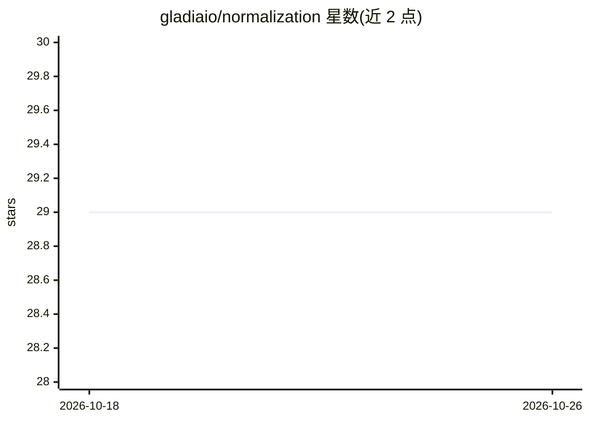

# gladiaio/normalization

⭐ 29 · Python · MIT · 推送 2026-10-23 · [GitHub](https://github.com/gladiaio/normalization) · 组织维护

**语音转写文本归一化库：WER 计算前统一表层格式**

Python 库 gladia-normalization，用于在计算 WER（词错误率）之前对语音转写文本做归一化：将 ground truth 与 STT 输出统一到同一规范形式，消除缩写展开、符号转文字、大小写等格式差异造成的虚假错误。流水线由 YAML preset 声明，固定三阶段（全文预处理、逐词处理、全文后处理），输出确定性。支持 9 种欧洲语言的内置 preset，可自定义 preset；不支持的语言回退到语言无关的默认归一化。提供 CLI（含 uvx 免安装运行）与 Python API。源自 Gladia 内部 ASR 基准测试工具，MIT 许可。

## 筛选速览

| 维度 | 判定 | 备注 |
|---|---|---|
| AI 角色 | `ai-ecosystem` | LLM/agent 周边工具 |
| 许可风险 | `permissive` | MIT |
| 部署形态 | `library` | 以包/库形式分发 |
| 模型依赖 | — | README 未给出锁定关系 |
| 硬件要求 | — | 无带数字的原话,不猜 |
| 安装摩擦 | `low` | 无编译、无系统依赖或容器化 |
| 成熟度 | — | 结构信号不足 |

## 能力要点

- WER 计算前的确定性归一化流水线（缩写展开、符号转文字、filler 移除等）
- YAML preset 声明式定义流水线，三阶段固定顺序
- 内置 9 种欧洲语言 preset，支持自定义 preset 与新语言注册
- 提供 Python API 与 CLI，支持 uvx 直接运行

## 适用场景

- 基准测试多个 ASR 引擎时获得可比的 WER 分数
- 消除转写格式差异对 WER 的干扰
- 为新语言定制归一化规则

## 场景标签

`模型评测` `语音识别` · 领域:评测与运维

## 证据(README 行号)

> L13: Word Error Rate (WER) is the standard metric for evaluating speech-to-text systems. But WER operates on raw strings
> L23: `gladia-normalization` solves this by reducing both the ground truth and the STT output to a shared canonical form 
> L154: `gladia-normalization` grew out of internal tooling at Gladia, where we are building an audio intelligence platfor

## 星数曲线

2026-10-18 29 → 2026-10-26 29（+0）

---
*卡片 v1 · prompt 1.4 · 生成 2026-10-26 · 置信度 high · 依据 README sha `a068af4a0749` · [字段定义](../../DATASET.md)*
