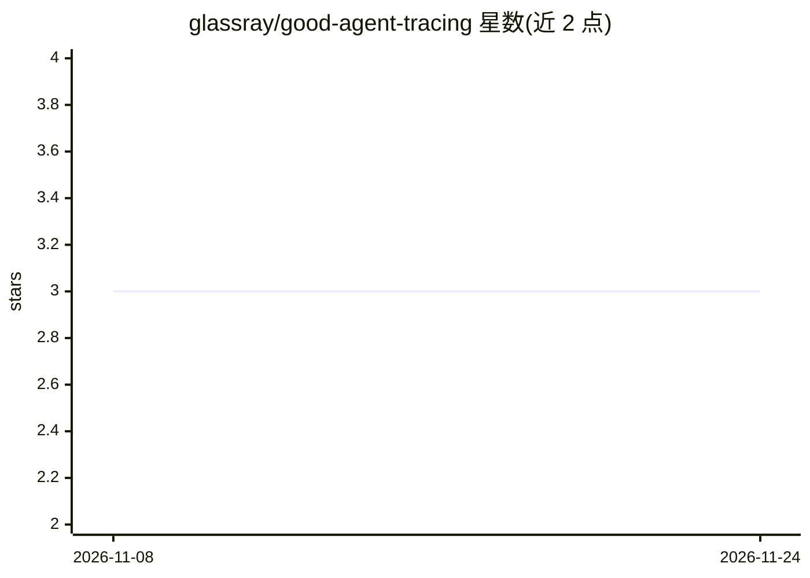

# glassray/good-agent-tracing

⭐ 3 · MIT · 推送 2026-11-06 · [GitHub](https://github.com/glassray/good-agent-tracing) · [官网](https://www.glassray.ai/blog/make-ai-traces-useful) · 组织维护

**给 AI agent 添加、审计并修复 OpenTelemetry 追踪的 agent skill**

以 Agent Skills 格式（SKILL.md + references 文件夹）分发，通过 Claude Code、Cursor、OpenAI Codex 等编码 agent 运行，提供三种模式：按 16 项清单审计现有追踪代码并输出 ok/partial/missing 报告、逐项修复且不改变 agent 行为、为无追踪的 agent 添加追踪。基于 OpenTelemetry，trace 可发送到任何接受 OTLP 的后端；未选后端时先配置 console exporter。支持 Python 与 TypeScript 示例与安装帮助。

## 筛选速览

| 维度 | 判定 | 备注 |
|---|---|---|
| AI 角色 | `ai-ecosystem` | LLM/agent 周边工具 |
| 许可风险 | `permissive` | MIT |
| 部署形态 | `None` |  |
| 模型依赖 | — | README 未给出锁定关系 |
| 硬件要求 | — | 无带数字的原话,不猜 |
| 安装摩擦 | `low` | 无编译、无系统依赖或容器化 |
| 成熟度 | `idea` | |

## 能力要点

- 16 项追踪检查清单（结构、记录内容、版本对比、安全与成本）
- 审计输出逐条报告及文件与行号定位
- 提供 Python 与 TypeScript 的 OpenTelemetry 配置与助手参考
- 支持 Claude Code、Cursor、OpenAI Codex 及任意读取 SKILL.md 的 agent

## 适用场景

- 让编码 agent 审计现有 agent 的追踪代码并找出缺失项
- 为只有 SDK 自动埋点的 agent 补全工具调用与检索记录
- 修复后用 LLM judge 或人工回看 agent 的执行过程与出错位置

## 场景标签

`LLM 可观测性` · 领域:评测与运维

## 证据(README 行号)

> L24: It uses OpenTelemetry, so the traces work in any backend that accepts OTLP: Glassray, Langfuse,
> L25: LangSmith, Braintrust, Arize Phoenix, Jaeger and others. It runs in Claude Code, Cursor and OpenAI

## 星数曲线

2026-11-08 3 → 2026-11-24 3（+0）

---
*卡片 v1 · prompt 1.4 · 生成 2026-11-22 · 置信度 high · 依据 README sha `43d5e8892966` · [字段定义](../../DATASET.md)*
