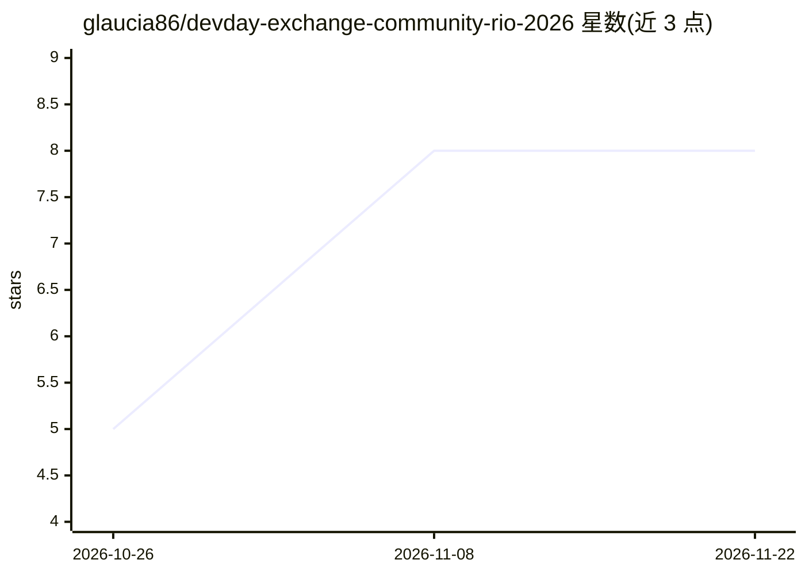

# glaucia86/devday-exchange-community-rio-2026

⭐ — · [GitHub]() · 个人维护

**面向开发者的 DevDay Rio 2026 meetup 葡语材料与 LAB 教程**

为 2026 年 10 月在里约热内卢举办的 DevDay Exchange Community Meetup 提供的葡萄牙语活动资料库：包含活动日程、演讲脚本、主持人指南和四个可在家复现的 LAB（Dots、Codex CLI、Codex Cloud、Decisions API）。附带本地可运行的 Next.js 演示应用（Alô, TI 假想客服台与 Triagem ao vivo 语音分诊页），需 Node.js 24.12.0–24.21.0，通过 git clone 与 npm ci 安装；离线测试与 mock 模式不需 OpenAI 账号或 API key。

## 筛选速览

| 维度 | 判定 | 备注 |
|---|---|---|
| AI 角色 | `ai-knowledge` | 知识聚合/清单类 |
| 许可风险 | `permissive` | — |
| 部署形态 | `library` | 以包/库形式分发 |
| 模型依赖 | — | README 未给出锁定关系 |
| 硬件要求 | — | 无带数字的原话,不猜 |
| 安装摩擦 | `low` | 无编译、无系统依赖或容器化 |
| 成熟度 | — | 结构信号不足 |

## 能力要点

- 四个 LAB：Dots、Codex CLI、Codex Cloud、Decisions API，各含步骤与预期结果
- 本地演示应用含 Triagem ao live 语音分诊页，使用 GPT-Live 与 Decisions API
- 离线测试与 mock 模式不需 OpenAI 账号或 API key
- 含舞台脚本、主持人指南与验证记录等活动材料

## 适用场景

- 报名参加 meetup 后在家按 LAB 复现演示
- 练习 TypeScript 代码修改并对照 diff 与测试
- 准备同类社区活动的演讲流程参考

## 场景标签

`教程课程` · 领域:学习与行业

## 证据(README 行号)

> L46: Este repositório reúne **material original em português** para acompanhar o encontro e continuar praticando depois 
> L68: São **quatro demonstrações, cada uma com um LAB para reproduzir em casa**. Os roteiros são independentes para estud

## 星数曲线

2026-10-26 5 → 2026-11-22 8（+3）

---
*卡片 v1 · prompt 1.4 · 生成 2026-11-20 · 置信度 high · 依据 README sha `07a24d2da729` · [字段定义](../../DATASET.md)*
