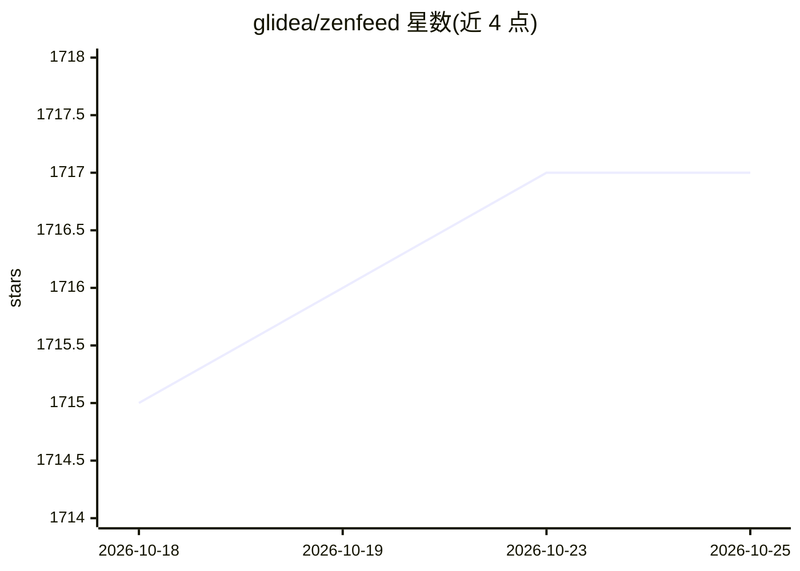

# glidea/zenfeed

⭐ 1,716 · Go · AGPL-3.0 · 推送 2026-07-10 · [GitHub](https://github.com/glidea/zenfeed) · [官网](https://zenfeed.xyz) · 个人维护 · 中文 README

**AI 信息中枢：智能 RSS 阅读器、新闻知识库与事件监控简报**

zenfeed 是一个自托管的 AI 信息中枢服务，以 Docker Compose 一键部署。它聚合用户订阅的 RSS 源，通过 LLM 管道对每篇内容做评分、分类、摘要与过滤（类 Prometheus Relabeling 的标签化机制），支持每日定时 AI 简报、指定事件监控与通知、语义查询，并可作为 RSSHub 的 MCP Server 供 Cherry Studio 等客户端连接。默认使用硅基流动的 Qwen3 系列模型，需配置 API Key。限制：1.0 前不保证向后兼容、无认证机制不宜暴露公网、数据默认仅存 8 天，AGPLv3 协议。

## 筛选速览

| 维度 | 判定 | 备注 |
|---|---|---|
| AI 角色 | `ai-native` | 本体是模型或模型工具 |
| 许可风险 | `viral` | AGPL-3.0 |
| 部署形态 | `None` |  |
| 模型依赖 | — | README 未给出锁定关系 |
| 硬件要求 | — | 无带数字的原话,不猜 |
| 安装摩擦 | `low` | 无编译、无系统依赖或容器化 |
| 成熟度 | `idea` | |

## 能力要点

- LLM 管道化标签处理：自定义 Prompt 实现评分/分类/摘要/过滤
- 每日定时 AI 简报与指定事件监控通知
- 可作为 RSSHub 的 MCP Server，提供 Query API 与 Notify Webhook
- Docker Compose 一键部署，大量声明式 YAML 配置

## 适用场景

- 订阅 RSS 后让 AI 自动筛选总结，减少信息噪音
- 每日定时收取指定时段的 AI 简报，总览式阅读
- 持续监控指定事件并接收通知与分析报告
- 在 Cherry Studio 等 MCP 客户端中把订阅源接入 AI 工作流

## 场景标签

`知识库管理` `精选清单` · 领域:知识与检索

## 证据(README 行号)

> L15: zenfeed 是你的 AI 信息中枢 。它既是 智能 RSS 阅读器 ，也是实时 "新闻"知识库 ，更能成为帮你时刻关注"指定事件"，并呈递 分析报告 的私人秘书。
> L81: * **管道化处理机制**: 类似 Prometheus 的 Relabeling，zenfeed 将每篇内容抽象为标签集，你可以在管道的每个节点，通过自定义 Prompt 对标签进行处理（评分、分类、摘要、过滤等）。
> L100: > zenfeed 默认使用 硅基流动 提供的模型服务。

## 星数曲线

2026-10-18 1,715 → 2026-10-25 1,717（+2）

---
*卡片 v1 · prompt 1.4 · 生成 2026-10-21 · 置信度 high · 依据 README sha `28fbb1a1dd8b` · [字段定义](../../DATASET.md)*
