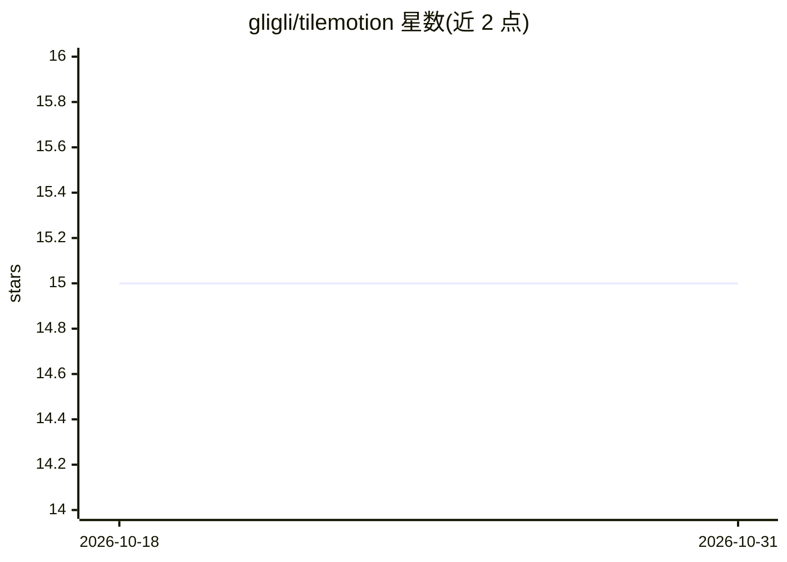

# gligli/tilemotion

⭐ 15 · Pascal · GPL-3.0 · 推送 2026-07-15 · [GitHub](https://github.com/gligli/tilemotion) · [官网](https://gligli.github.io/tilemotion/) · 个人维护

**解码端极简的视频编解码器，解码器仅需 JavaScript/Canvas**

GliGli 开发的有损视频编解码器，目标是让解码计算开销极低且实现极为简单：参考解码器全部用 JavaScript 编写并以 HTML5 Canvas 播放。编码器主体为 FreePascal 加 x64 SSE3 汇编并带 GUI，比特流经 LZMA2 压缩，帧结构类似老式游戏主机的 tilemap（8x8 索引块 + RGBA8888 调色板 + 镜像/调色板属性）。压缩率接近 MPEG-4/AVC 一类编解码器但码率需求更高；编码极耗 CPU，短视频可能耗时数小时。项目处于 Release 阶段，提供 releases 二进制下载与在线演示。

## 筛选速览

| 维度 | 判定 | 备注 |
|---|---|---|
| AI 角色 | `ai-enhanced` | 去掉 AI 部分产品仍成立 |
| 许可风险 | `viral` | GPL-3.0 |
| 部署形态 | `None` |  |
| 模型依赖 | — | README 未给出锁定关系 |
| 硬件要求 | — | 无带数字的原话,不猜 |
| 安装摩擦 | `low` | 无编译、无系统依赖或容器化 |
| 成熟度 | — | 结构信号不足 |

## 能力要点

- 参考解码器全部 JavaScript 实现，仅依赖 HTML5 Canvas
- 基于关键帧/帧/调色板/tilemap/8x8 瓦片的帧结构
- 比特流使用 LZMA2 压缩，解码开销与解压相当
- 编码器为 FreePascal + x64 SSE3 汇编并带 GUI

## 适用场景

- 在低算力环境中播放压缩视频（浏览器即可解码）
- 研究基于瓦片/调色板的视频压缩方案
- 下载 releases 二进制并使用 GUI 编码器压片体验

## 场景标签

 · 领域:多媒体/视频编解码

## 证据(README 行号)

> L1: # GliGli's TileMotion video codec
> L7: The **reference decoder** is written entirely in *javascript* and uses *HTML5 Canvas* to decode, proving that minima

## 星数曲线

2026-10-18 15 → 2026-10-31 15（+0）

---
*卡片 v1 · prompt 1.4 · 生成 2026-10-31 · 置信度 low · 依据 README sha `6ad5d1141cfc` · [字段定义](../../DATASET.md)*
