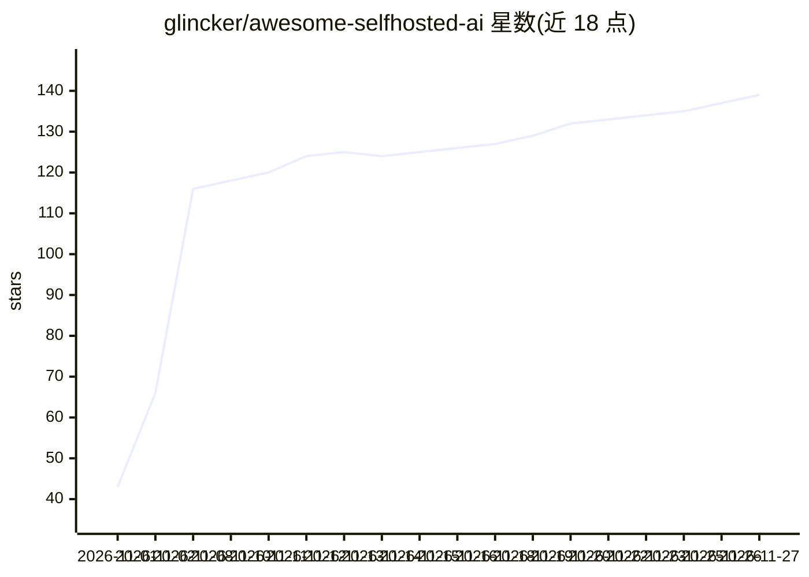

# glincker/awesome-selfhosted-ai

⭐ 139 · JavaScript · CC0-1.0 · 推送 2026-11-11 · [GitHub](https://github.com/glincker/awesome-selfhosted-ai) · [官网](https://github.com/glincker/awesome-selfhosted-ai/blob/main/LIVE.md) · 个人维护

**可自托管开源 AI 项目策展清单（309 个，每周健康检查）**

按类别组织的自托管开源 AI 项目清单，覆盖本地 LLM、聊天界面、编程助手、文档 OCR、微调训练、个人 AI、图像视频生成等方向。每周通过 GitHub API 检查每个收录项目的状态，已归档、删除或超过一年无动静的项目自动移入 UNMAINTAINED.md，并维护含星数、最后提交与许可证的健康表。面向想在自己硬件或服务器上运行开源 AI 的用户，本身不提供软件，只提供项目索引。

## 筛选速览

| 维度 | 判定 | 备注 |
|---|---|---|
| AI 角色 | `ai-knowledge` | 知识聚合/清单类 |
| 许可风险 | `viral` | CC0-1.0 |
| 部署形态 | `None` |  |
| 模型依赖 | — | README 未给出锁定关系 |
| 硬件要求 | — | 无带数字的原话,不猜 |
| 安装摩擦 | `medium` | 含编译或系统依赖之一 |
| 成熟度 | — | 结构信号不足 |

## 能力要点

- 309 个项目，覆盖 agents/聊天/OCR/微调/图像视频生成等类别
- 每周 GitHub API 健康检查，死项目自动移入 UNMAINTAINED.md
- 附星数、最后推送与许可证的实时健康表

## 适用场景

- 为 homelab 挑选可在自己硬件上运行的开源 AI 项目
- 寻找特定类别的可自托管替代方案（聊天 UI、RAG、OCR 等）
- 了解本地 AI 生态中哪些项目仍在活跃维护

## 场景标签

`精选清单` · 领域:学习与行业

## 证据(README 行号)

> L3: > Open-source AI you can run on your own hardware or server.
> L5: 309 projects across local LLMs, chat interfaces, agents, MCP servers, RAG, speech and image generation. A weekly job
> L7: **309** projects | **306** active in the last 90 days | **10.8M** combined stars | **0** unmaintained | refreshed 20

## 星数曲线

2026-11-01 43 → 2026-11-27 139（+96）

---
*卡片 v1 · prompt 1.4 · 生成 2026-11-27 · 置信度 high · 依据 README sha `0191081d61c5` · [字段定义](../../DATASET.md)*
