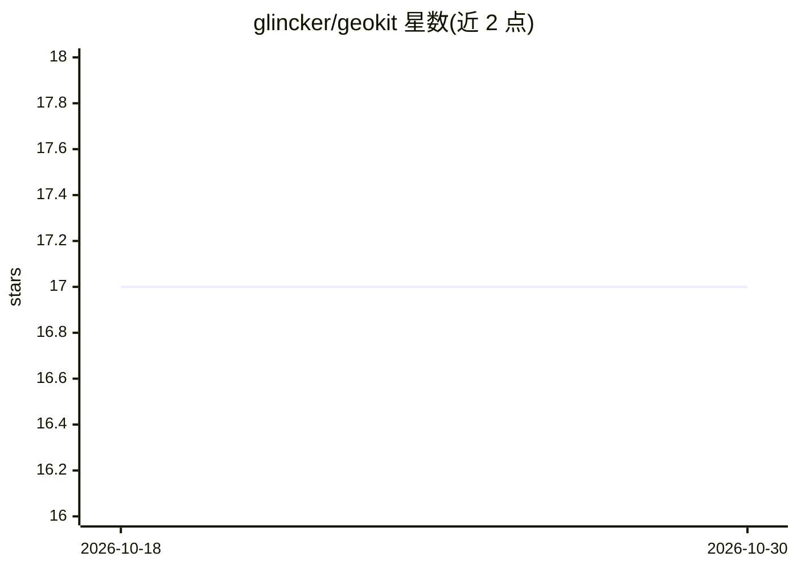

# glincker/geokit

⭐ 17 · TypeScript · MIT · 推送 2026-04-12 · [GitHub](https://github.com/glincker/geokit) · [官网](https://geokit.dev) · 组织维护

**网站 AI 就绪度审计工具：给网站打 0-100 分（GEO 版 Lighthouse）**

面向开发者的 Generative Engine Optimization（GEO）工具集，npm 单仓多包发布：geo-audit CLI 抓取任意 URL，按 20 条规则、4 大类（AI 可发现性 40 分、结构化数据 35 分、内容质量 38 分、技术 21 分）输出 0-100 的 AI 就绪度评分；geo-seo 生成 llms.txt、JSON-LD、robots.txt、sitemap，并提供 Next.js/Vite/Astro/Nuxt 框架适配器；geomark 将 URL 转 markdown；geokit 统一 CLI 含自动修复管道。另提供 GitHub Action 可接入 CI 并在 PR 评论报告。

## 筛选速览

| 维度 | 判定 | 备注 |
|---|---|---|
| AI 角色 | `ai-ecosystem` | LLM/agent 周边工具 |
| 许可风险 | `permissive` | MIT |
| 部署形态 | `library` | 以包/库形式分发 |
| 模型依赖 | — | README 未给出锁定关系 |
| 硬件要求 | — | 无带数字的原话,不猜 |
| 安装摩擦 | `low` | 无编译、无系统依赖或容器化 |
| 成熟度 | — | 结构信号不足 |

## 能力要点

- 20 条规则 4 类评分，输出 0-100 分与等级/徽章
- 生成 llms.txt、JSON-LD、robots.txt、sitemap 等 AI 可发现性文件
- 4 个框架适配器（Next.js/Vite/Astro/Nuxt）
- GitHub Action 支持 CI 集成、分数阈值与 PR 评论

## 适用场景

- 检查我的网站能否被 ChatGPT/Claude/Perplexity 等 AI 爬虫正确读取和引用
- 自动生成 llms.txt 与结构化数据提升 AI 搜索可见性
- 在 CI 中对每次部署做 AI 就绪度回归检查

## 场景标签

 · 领域:Web 开发/AI 搜索优化

## 证据(README 行号)

> L12: GeoKit is a suite of developer tools for **Generative Engine Optimization (GEO)** — making your website visible to 
> L22: |`@glincker/geo-audit`|CLI that scores any website's AI-readiness 0-100|Published|
> L56: **20 rules** across 4 categories, normalized to a 0-100 score:

## 星数曲线

2026-10-18 17 → 2026-10-30 17（+0）

---
*卡片 v1 · prompt 1.4 · 生成 2026-10-29 · 置信度 high · 依据 README sha `3c68be4e8552` · [字段定义](../../DATASET.md)*
