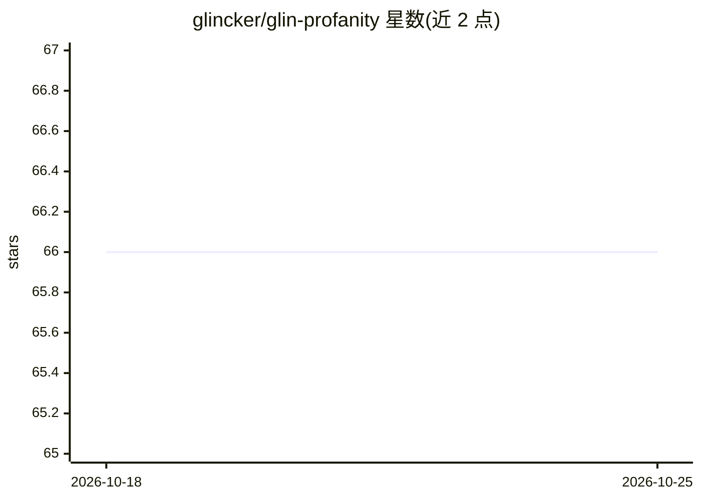

# glincker/glin-profanity

⭐ 66 · TypeScript · MIT · 推送 2026-10-23 · [GitHub](https://github.com/glincker/glin-profanity) · [官网](https://www.glincker.com/tools/glin-profanity) · 组织维护

**给开发者的离线内容检测库：脏话/PII/密钥/提示注入过滤**

MIT 许可的脏话与内容检测库，提供 npm 与 PyPI 双语言包及 MCP 服务器（24 个工具），供 Claude Desktop、Cursor、Windsurf 等 AI 助手原生调用。核心机制：24 种语言的词典过滤、leetspeak 与 Unicode 同形字混淆检测、可选的 TensorFlow.js ML 毒性模型、提示注入扫描（50 模式）、密钥检测（110 模式+熵值）与 PII 检测/脱敏（含 Vault 可逆替换）。完全离线运行，核心包 12 KB，支持 Edge/浏览器。计划 2026 年发布自有蒸馏毒性模型。

## 筛选速览

| 维度 | 判定 | 备注 |
|---|---|---|
| AI 角色 | `ai-native` | 本体是模型或模型工具 |
| 许可风险 | `permissive` | MIT |
| 部署形态 | `library` | 以包/库形式分发 |
| 模型依赖 | — | README 未给出锁定关系 |
| 硬件要求 | — | 无带数字的原话,不猜 |
| 安装摩擦 | `low` | 无编译、无系统依赖或容器化 |
| 成熟度 | — | 结构信号不足 |

## 能力要点

- 24 种语言词典 + leetspeak 与 Unicode 同形字混淆检测
- 可选 TensorFlow.js ML 毒性检测（按类别打分）
- 提示注入/密钥/PII 三类扫描器，PII 支持 Vault 可逆脱敏
- MCP 服务器提供 24 个工具接入 Claude/Cursor/Windsurf

## 适用场景

- 聊天平台实时过滤消息脏话与混淆变体
- AI 管道中拦截 PII 与密钥泄漏、扫描提示注入
- 为 AI 助手（Claude Desktop/Cursor）接入内容检测工具

## 场景标签

 · 领域:内容审核/AI 安全工具

## 证据(README 行号)

> L22:  Glin Profanity - ML-Powered Profanity Detection
> L265: |`check_prompt_injection`|Scan text for prompt injection attacks (rule-based, 50 patterns)|

## 星数曲线

2026-10-18 66 → 2026-10-25 66（+0）

---
*卡片 v1 · prompt 1.4 · 生成 2026-10-24 · 置信度 high · 依据 README sha `6a23745e57d5` · [字段定义](../../DATASET.md)*
