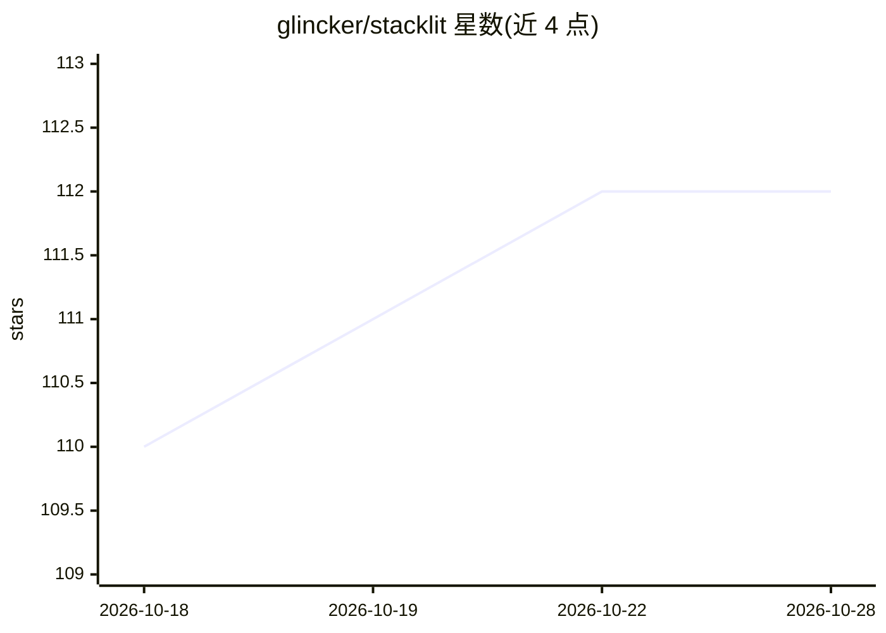

# glincker/stacklit

⭐ 112 · Go · MIT · 推送 2026-05-07 · [GitHub](https://github.com/glincker/stacklit) · [官网](https://www.npmjs.com/package/stacklit) · 个人维护

**一条命令生成代码库索引，为 AI 编程代理提供即用上下文**

用 tree-sitter 解析 11 种语言的源码结构（imports、exports、类型、依赖），生成约 250-4000 token 的 stacklit.json 索引、DEPENDENCIES.md 依赖图和交互式 HTML 可视化地图，替代代理扫描全库的 token 消耗。支持自动配置 Claude Code、Cursor、Aider（注入导航图、MCP 服务器、git hook），另有 GitHub Action 保持索引更新。通过 npx/npm/go install 安装或下载二进制，本地解析、不发送代码（可选 --summary 才调用 Claude API）。面向使用 AI 编程代理的开发者。

## 筛选速览

| 维度 | 判定 | 备注 |
|---|---|---|
| AI 角色 | `ai-ecosystem` | LLM/agent 周边工具 |
| 许可风险 | `permissive` | MIT |
| 部署形态 | `library` | 以包/库形式分发 |
| 模型依赖 | — | README 未给出锁定关系 |
| 硬件要求 | — | 无带数字的原话,不猜 |
| 安装摩擦 | `low` | 无编译、无系统依赖或容器化 |
| 成熟度 | — | 结构信号不足 |

## 能力要点

- tree-sitter 解析 11 种语言的结构化索引
- 一条命令自动配置 Claude Code / Cursor / Aider 与 MCP 集成
- MCP 服务器暴露 7 个查询工具
- git hook 与 GitHub Action 用 Merkle 哈希增量更新索引
- monorepo 自动检测（pnpm/Nx/Turborepo/Cargo 等）

## 适用场景

- 让 AI 编程代理用少量 token 理解大型代码库结构
- 在 CI 中自动维护代码库索引并对陈旧索引拦截 PR
- 生成代码库依赖图与可视化视图供团队查阅

## 场景标签

 · 领域:开发者工具/AI 编程基础设施

## 证据(README 行号)

> L67: Done. Every AI agent that opens this repo can now read `stacklit.json` instead of scanning files.
> L107: Auto-detects Claude Code, Cursor, and Aider. For each:
> L154: MCP server exposes 7 tools: `get_overview`, `get_module`, `find_module`, `list_modules`, `get_dependencies`, `get_

## 星数曲线

2026-10-18 110 → 2026-10-28 112（+2）

---
*卡片 v1 · prompt 1.4 · 生成 2026-10-23 · 置信度 high · 依据 README sha `04c703d87346` · [字段定义](../../DATASET.md)*
