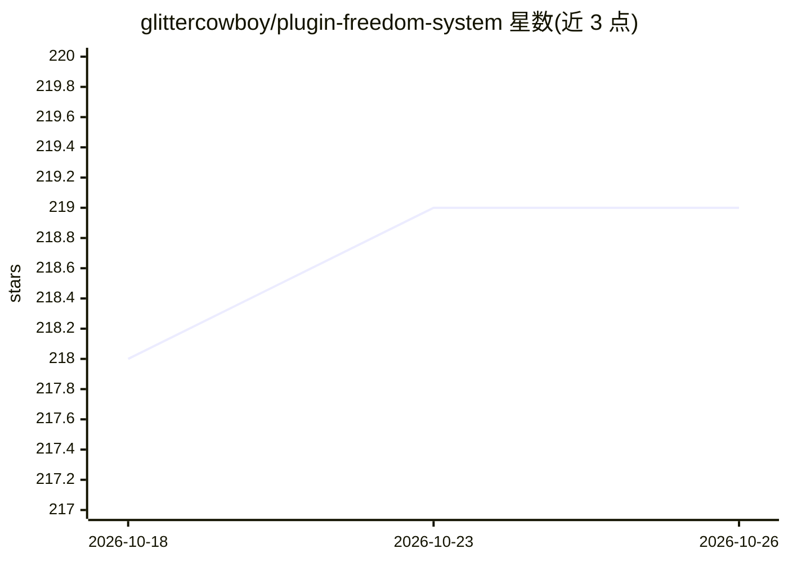

# glittercowboy/plugin-freedom-system

⭐ 219 · HTML · 推送 2025-11-19 · [GitHub](https://github.com/glittercowboy/plugin-freedom-system) · [官网](https://youtu.be/RsZB1K8oH0c) · 个人维护

**让音乐人用对话在 macOS 上创建 VST3/AU 插件的 AI 开发系统**

运行于 Claude Code 之上的音频插件开发系统：用户通过 /dream、/plan、/implement 等斜杠命令，以自然语言对话方式设计并构建 JUCE VST3/AU 插件，面向无编程经验的音乐人、制作人与声音设计师。机制上采用不可变契约（创意简报/参数规格/架构）作为单一事实来源，三阶段实现各由独立子代理（结构/DSP/WebView UI）执行并强制通过 pluginval 验证，附 7 阶段自动构建管线与故障知识库。限制：仅支持 macOS 13+，需 Claude Code CLI，产物需本地编译。

## 筛选速览

| 维度 | 判定 | 备注 |
|---|---|---|
| AI 角色 | `ai-ecosystem` | LLM/agent 周边工具 |
| 许可风险 | `none` | — |
| 部署形态 | `None` |  |
| 模型依赖 | locked-api |  |
| 硬件要求 | — | 无带数字的原话,不猜 |
| 安装摩擦 | `medium` | 含编译或系统依赖之一 |
| 成熟度 | — | 结构信号不足 |

## 能力要点

- 对话式 3 阶段插件构建流程（结构/DSP/UI），每阶段自动验证阻断错误
- 插件 UI 用 HTML/CSS/JS 经 JUCE WebView 渲染，支持无 UI 的 headless 模式
- 7 阶段构建管线自动完成验证、编译、安装，无需手动 CMake/Xcode 配置
- 双索引故障知识库与 Required Reading 自动注入子代理上下文

## 适用场景

- 不会编程的音乐人把混响、合成器等想法做成 DAW 可用的插件
- 快速迭代音频效果器原型并自动回归测试
- 通过 /improve /research 修复和改进已有插件

## 场景标签

`编码 Agent` · 领域:编码与开发

## 证据(README 行号)

> L3: An AI-assisted JUCE plugin development system that enables conversational creation of professional VST3 and AU audio
> L150: - `foundation-shell-agent` (Stage 1) - Project structure and parameter management
> L184: - Claude Code CLI

## 星数曲线

2026-10-18 218 → 2026-10-26 219（+1）

---
*卡片 v1 · prompt 1.4 · 生成 2026-10-22 · 置信度 high · 依据 README sha `115463f12e72` · [字段定义](../../DATASET.md)*
