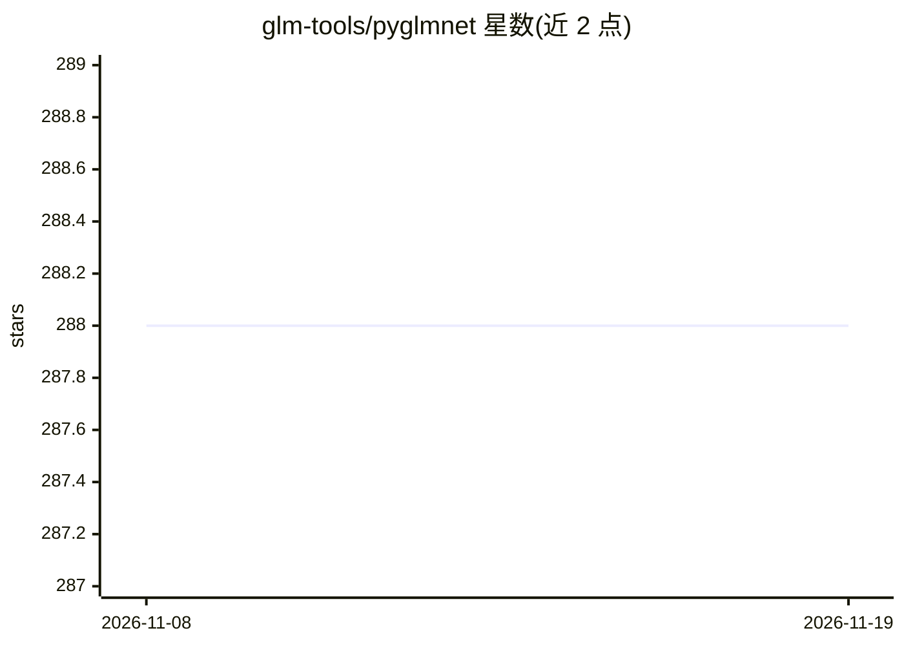

# glm-tools/pyglmnet

⭐ 288 · Python · MIT · 推送 2026-11-08 · [GitHub](https://github.com/glm-tools/pyglmnet) · [官网](http://glm-tools.github.io/pyglmnet/) · 组织维护

**弹性网正则化广义线性模型的纯 Python 实现**

提供 GLM 估计器的 Python 库：支持 gaussian/binomial/probit/gamma/poisson/softplus 六种噪声模型及配对链接函数，正则化覆盖 ridge、lasso、elastic net、group lasso 与 Tikhonov。优化器为带 Newton 更新的循环坐标下降，含活跃集、更新缓存与热启动，与 R glmnet 包所用方法相同。与 R glmnet 的 Python 封装不同，本库为纯 Python 实现，便于修改和扩展。面向数据分析与科研用户，配套教程、示例与 JOSS 论文。

## 筛选速览

| 维度 | 判定 | 备注 |
|---|---|---|
| AI 角色 | `ai-native` | 本体是模型或模型工具 |
| 许可风险 | `permissive` | MIT |
| 部署形态 | `library` | 以包/库形式分发 |
| 模型依赖 | — | README 未给出锁定关系 |
| 硬件要求 | — | 无带数字的原话,不猜 |
| 安装摩擦 | `low` | 无编译、无系统依赖或容器化 |
| 成熟度 | — | 结构信号不足 |

## 能力要点

- 6 种噪声模型与配对链接函数
- 支持 ridge/lasso/elastic net/group lasso/Tikhonov 正则化
- 循环坐标下降优化器（Newton 更新、活跃集、热启动），与 R glmnet 方法相同
- 纯 Python 实现，无需依赖 R 环境

## 适用场景

- 用泊松或二项 GLM 拟合稀疏高维数据并做预测
- 需要 elastic net 或 group lasso 正则化的回归分析
- 在纯 Python 环境中复现 R glmnet 风格的建模流程

## 场景标签

 · 领域:机器学习/统计建模

## 证据(README 行号)

> L3: A python implementation of elastic-net regularized generalized linear models
> L12: - Pyglmnet provides a wide range of noise models (and paired canonical

## 星数曲线

2026-11-08 288 → 2026-11-19 288（+0）

---
*卡片 v1 · prompt 1.4 · 生成 2026-11-17 · 置信度 high · 依据 README sha `c8fef5f31a22` · [字段定义](../../DATASET.md)*
